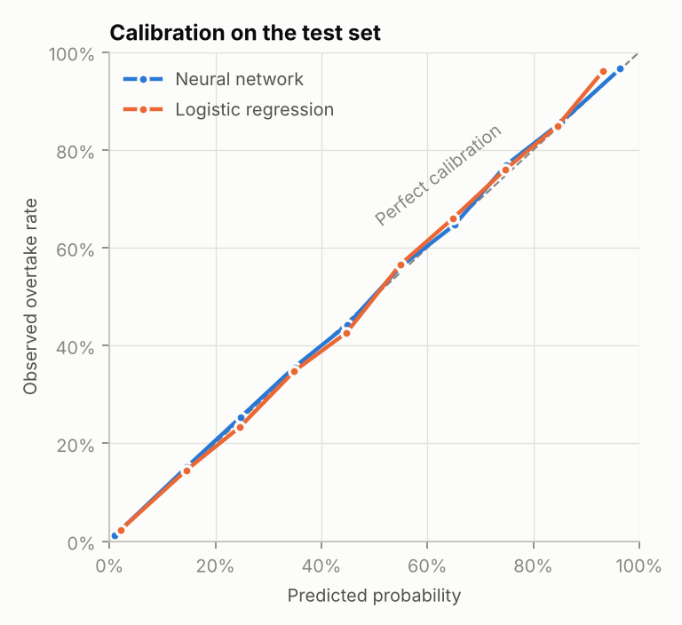
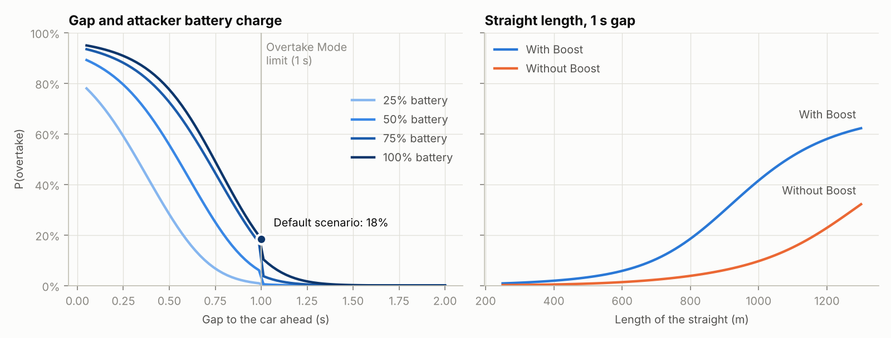
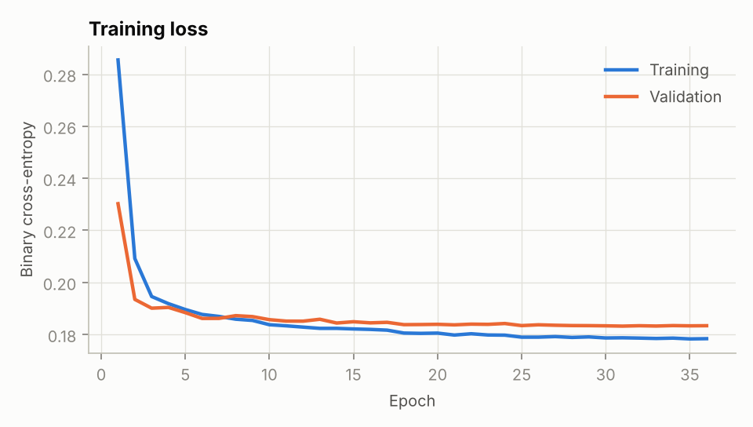

# Gazzola3001

## Introduction

A neural network that estimates the probability of an F1 overtake under the
2026 rules, given the race situation: track conditions, where on the lap the
attack happens, both cars' tyres and battery charge, whether each driver uses
**Boost**, whether the attacker has **Overtake Mode**, the gap, and the drivers.

```
$ python -m overtake.predict --condition dry --tyre soft --segment straight --battery 100 --gap 1.0

Scenario
  Track:    dry, 35 C, generic, straight (800 m run)
  Attacker: soft (5 laps), battery 100%, Boost on, Overtake Mode on, skill 85
  Defender: medium (15 laps), battery 50%, Boost on, skill 85
  Gap:      1.00 s

P(overtake) = 18.5%
  without Boost: 3.8%  (Boost adds +14.7 points)

Same situation at other gaps
  0.25 s   90.8%
  0.50 s   77.5%
  0.75 s   49.1%
  1.00 s   18.5%
  1.25 s    1.6%
  1.50 s    0.2%
```

## The 2026 rules being modelled

- **Boost**: a driver-operated mode giving the maximum combined power from the
  engine and battery. It can be used anywhere on the lap, to attack or defend,
  as long as the battery has charge.
- **Overtake Mode** (replaces DRS): available on the next lap when a car is
  within one second of the car ahead at the detection point. It gives an extra
  0.5 MJ of energy and a power profile that holds high speed for longer.
- **Active aero** (straight mode) is used by every car on the straights, so it
  is not an overtaking aid and is not an input.

Sources: [Formula1.com](https://www.formula1.com/en/latest/article/explained-the-new-key-terms-for-formula-1s-new-for-2026-rules.3T5BU6TC9quGcIpGzoWkY0),
[ESPN](https://www.espn.com/f1/story/_/id/47333501/),
[The Race](https://www.the-race.com/formula-1/boost-overtake-mode-active-aero-recharge-key-2026-terms-explained),
[F1 Technical](https://www.f1technical.net/news/28127).

## How it works

### 1. Training data from a race simulator (`overtake/simulator.py`)

There is no public dataset of 2026 overtaking attempts that records battery
charge and Boost / Overtake Mode use, so the network is trained on attempts
generated by a physics-informed Monte Carlo simulator. Each attempt runs in two
stages:

1. **Closing**: how much of the gap the attacker removes before the braking
   point. Electrical deployment on both cars (battery charge, Boost, Overtake
   Mode), car straight-line speed, slipstream, corner-exit grip from tyres
   (compound, age, track temperature, wet/dry), dirty air and the defender's
   positioning all count, plus random execution noise.
2. **Completion**: if the attacker gets within lunging range, whether the move
   sticks. This depends on the margin, the drivers' ratings, braking grip, the
   corner type, the weather and the circuit.

Each simulated attempt ends in a 0/1 outcome, which is what real data would
look like. The constants are estimates chosen to give plausible magnitudes,
not values measured from F1 data. Change them to test other assumptions.

### 2. The network (`overtake/model.py`)

- Categorical inputs (track condition, segment, circuit, both tyre compounds)
  go through learned **embeddings**. Both tyre columns share one tyre
  embedding, so a "soft" means the same thing for either car.
- Numeric inputs are standardised; Boost and Overtake Mode are 0/1 flags.
- A multilayer perceptron (128 → 128 → 64, SiLU, dropout 0.1) outputs one
  logit, and a sigmoid turns it into P(overtake).
- Trained with binary cross-entropy, AdamW, learning-rate decay on plateau and
  early stopping on validation loss (`overtake/train.py`).

### 3. Evaluation

300,000 simulated attempts, split 80/10/10. The baseline is a logistic
regression on the same inputs, which cannot model interactions such as "a
battery advantage matters more on a long straight".

| Test set (30,000 attempts)           | Neural network | Logistic regression |
|--------------------------------------|---------------:|--------------------:|
| Log loss (lower is better)           | 0.184          | 0.273               |
| Brier score (lower is better)        | 0.058          | 0.084               |
| ROC AUC (higher is better)           | 0.960          | 0.904               |
| Mean error vs true probability       | **1.4 points** | 8.4 points          |

Because the simulator can replay any situation thousands of times, we know the
*true* probability of each test situation. The last row compares each model
against that truth (2,000 test situations, 400 replays each). The network gets
within about 1.4 percentage points on average.





The left what-if panel shows the probability dropping sharply at 1.0 s:
beyond that, the attacker loses Overtake Mode.

## Inputs

| Column | Meaning | Default |
|---|---|---|
| `track_condition` | `dry`, `damp`, `wet` | dry |
| `segment` | `straight`, `slow_corner`, `medium_corner`, `fast_corner` | straight |
| `circuit` | one of 24 circuits or `generic` (see `features.CIRCUITS`) | generic |
| `run_length_m` | metres of straight before the braking point | 800 |
| `gap_s` | gap to the car ahead, seconds | 1.0 |
| `attacker_tyre`, `defender_tyre` | `soft`, `medium`, `hard`, `intermediate`, `wet` | soft, medium |
| `attacker_tyre_age`, `defender_tyre_age` | laps | 5, 15 |
| `attacker_battery`, `defender_battery` | state of charge, % | 100, 50 |
| `attacker_boost`, `defender_boost` | driver uses Boost | yes, yes |
| `overtake_mode` | attacker within 1 s at the detection point | gap ≤ 1 s |
| `attacker_skill`, `defender_skill` | racecraft rating, 0–100 | 85, 85 |
| `top_speed_delta_kph` | attacker car's straight-line speed advantage | 0 |
| `pace_delta_s` | attacker car's lap-time advantage, s/lap | 0 |
| `track_temp_c` | track temperature, °C | 35 |

## Quick start

```bash
pip install -r requirements.txt

# predict (a trained model is included in models/)
python -m overtake.predict --condition dry --tyre soft --segment straight --battery 100 --gap 1.0
python -m overtake.predict --help                    # every option

# retrain (about a minute on a laptop CPU); writes models/ and reports/
python -m overtake.train

# tests
python -m pytest
```

From Python:

```python
from overtake.predict import OvertakePredictor

predictor = OvertakePredictor.load()
predictor.predict({"track_condition": "dry", "attacker_tyre": "soft",
                   "segment": "straight", "attacker_battery": 100, "gap_s": 1.0})
```

## Training on real race data

`python -m overtake.train --data attempts.csv` trains the same network on any
CSV with the columns above plus `overtake` (1 = the move stuck). The tool
checks every value against the schema.

[FastF1](https://docs.fastf1.dev/) can supply gaps, positions, tyre compound
and age, weather and car telemetry. Battery state of charge and Boost use are
not in the public timing data. To build a real dataset you would need a proxy
for those (for example, speed-trap differences) or to leave them out. A
practical route is to pre-train on simulated data and then fine-tune on the
real attempts you can label.

## Limitations

- The network can only be as right as the simulator it learns from. Its
  results show what follows from the simulator's assumptions, not measured
  facts about 2026 F1.
- Driver ratings are single numbers; real racecraft has more dimensions.
- Each attempt is a single straight or corner. Multi-lap battles, energy saved
  for the next lap, team orders and safety cars are not modelled.

## Project layout

```
overtake/
  features.py    input schema, defaults, validation, preprocessing
  simulator.py   Monte Carlo simulator that produces training data
  model.py       the neural network
  train.py       training, evaluation, baseline, figures
  predict.py     command-line and Python prediction
  plots.py       report figures
models/          trained network
reports/         metrics.json and figures
tests/
```
