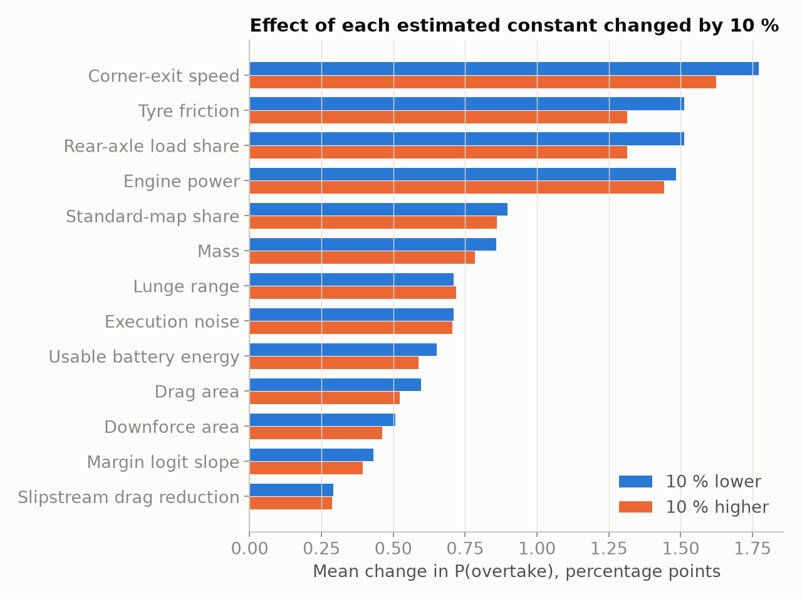
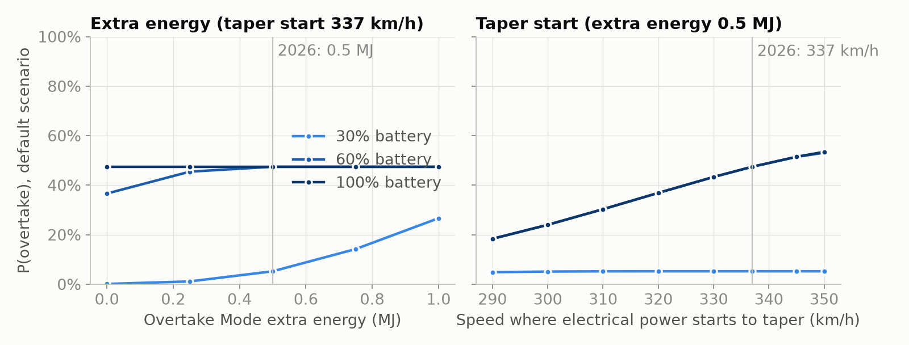

# Probability of an F1 overtake under the 2026 Boost and Overtake Mode rules

**MMA3001 Numerical Methods and Machine Learning: individual project report**
Sam Gazzola · Repository <https://github.com/SamGazz10/Gazzola3001> · October 2026

Every number in this report is produced by code in the repository from fixed
random seeds; Appendix D lists the command that regenerates each result. Code
documentation (generated from the docstrings) is in `docs/api/`.

## Summary

From 2026 a Formula 1 car within 1 s of the car ahead gets **Overtake Mode**
(0.5 MJ of extra battery energy and electrical power to a higher speed)
instead of DRS, and either driver can use **Boost**, the maximum engine plus
battery power. This project estimates the probability that an attempt
succeeds, P(overtake), from 19 inputs. A physics simulator integrates both
cars' equations of motion with fourth-order Runge-Kutta (RK4) and gives the
exact probability by Gauss-Legendre quadrature; a neural network trained only
on simulated 0/1 outcomes predicts it 20 times faster, with a mean error of
2.0 percentage points on 30,000 held-out attempts (gradient boosting 3.8,
logistic regression 15.7). Against 17 real 2026 races the physics holds up,
but the simulator makes passes from 0.5-1 s behind too easy, because real
drivers ration battery energy across the lap.

## 1. Engineering problem

**Context.** The 2026 power unit pairs a 400 kW engine with a 350 kW electric
motor-generator (MGU-K) on the rear axle and a battery of about 4 MJ usable
energy [1, 2, 5, 6], which full electrical power empties in about 11 s, less
than one long straight. Electrical power also tapers from 290 km/h to zero at
355 km/h; Overtake Mode, earned within 1 s of the car ahead at a detection
point, adds 0.5 MJ and full power to 337 km/h [1-4]. Overtaking has become a
mechanical-engineering problem of longitudinal vehicle dynamics and
hybrid-powertrain energy management: traction, drag, slipstream and how much
energy each car can deploy over the remaining distance.

**Problem.** Given the situation as the attacker leaves the corner before a
straight, estimate the probability that the attacker is ahead at the braking
point at the end of the straight and the move sticks.

**Why it matters.** Teams decide every lap whether to attack or recharge, and
drivers when to use Boost. A fast, calibrated probability lets a strategist
compare options ("attack now with 60 % charge, or next lap with 90 %?") and
shows rule makers which Overtake Mode parameter changes overtaking, and for
whom (Section 5.4).

**Intended use.** Decision support and what-if analysis, where many situations
must be evaluated quickly, and a training pipeline that can be retrained on
real labelled attempts (`python -m overtake.train --data`) once they exist.

**Scope and its limits.** One attempt on one straight, without energy strategy
across the lap; driver skill is one rating; safety cars and damage are out of
scope. Battery charge and Boost use are not in public timing data, so the
training data are simulated and the network can only be as right as the
simulator. In return the ground truth is exact, which makes rigorous
validation possible.

## 2. Inputs, outputs and data

**Inputs.** A scenario is one row (a Python dict, pandas row or CSV row) with
the 19 fields of Table 1. Omitted fields take the defaults, which together
form the *default scenario* used throughout this report.

*Table 1. Inputs (accepted range, with the training range in brackets where narrower).*

| Input | Meaning and units | Accepted (trained) | Default |
|---|---|---|---|
| `gap_s` | gap at the corner exit, s | 0-3 (0.05-2.0) | 1.0 |
| `run_length_m` | corner exit to braking point, m | 10-2000 (250-1300 straights, 50-300 corners) | 800 (150 into a corner) |
| `attacker_battery`, `defender_battery` | state of charge, % of 4 MJ | 0-100 | 100, 60 |
| `attacker_boost`, `defender_boost` | Boost used, flag | true/false or 1/0 | true, true |
| `overtake_mode` | within 1 s at the detection point, flag | true/false or 1/0 | `gap_s` ≤ 1 |
| `attacker_tyre`, `defender_tyre` | soft, medium, hard, intermediate, wet | listed | soft, medium |
| `attacker_tyre_age`, `defender_tyre_age` | laps | 0-80 (0-40) | 5, 15 |
| `track_condition`, `track_temp_c` | dry, damp or wet; °C | listed; 0-70 (10-55) | dry, 35 (20 damp or wet) |
| `segment` | where the move completes: straight, slow, medium or fast corner | listed | straight |
| `circuit` | one of 24 circuits, or `generic` | listed | generic |
| `attacker_skill`, `defender_skill` | racecraft rating (grid about 60-100) | 0-100 (60-100) | 85, 85 |
| `top_speed_delta_kph`, `pace_delta_s` | attacker car's advantage: straight-line speed, km/h; lap time, s/lap | ±30 (±15); ±3 (±1.5) | 0, 0 |

**Output.** P(overtake), the probability between 0 and 1 that this attempt
succeeds. It is calibrated against the simulator (Section 5.2): among
situations predicted at 30 %, about 30 % succeed in simulation, so options can
be compared directly. Real pass rates are lower at 0.5-1 s (Section 5.3).

**Invalid, missing and unsupported inputs.** An unknown category or field
name, a value outside the accepted range, text, NaN, a non-boolean flag or a
missing column raises a `ValueError` naming the field and the allowed values
(the command line exits with status 2). Omitted or `None` fields take their
defaults. Values outside the training range, or Overtake Mode inconsistent
with the gap, are predicted with a warning (Section 5.2 measures the cost); a
missing model file raises an error explaining how to train one. Function-level
inputs, outputs and exceptions are in NumPy-style docstrings (`docs/api/`).

**Data.** 300,000 simulated attempts (inputs sampled across the training
ranges; 15 % of batteries start full; 27 % succeed), split 80/10/10 into
training, validation and test sets and regenerated from fixed seeds. Real
timing data from 17 races of the 2026 season (OpenF1 [15]) are used for
validation only.

## 3. Computational approach

*Figure 1. Workflow. Top: the simulator generates 0/1 outcomes on which the
network is trained. Bottom: what checks each part.*

### 3.1 Physical model (`overtake/physics.py`)

Each car is a point mass moving along the straight, with position $x$, speed
$v$ and battery energy used $e$:

$$\dot x = v, \qquad m\,\dot v = \min(F_P, F_T) - F_D - F_R, \qquad \dot e = P_E .$$

* **Drive force** $F_P = \eta\,(P_{ICE} + P_E)/v$, with electrical power
  $P_E = s\,P_K(v)\,\min\big(1, (E-e)/S\big)$: $P_K$ is 350 kW to 290 km/h,
  falling to zero at 355 km/h (full power to 337 km/h with Overtake Mode); the
  deployment share $s$ is 1 with Boost and 0.55 on the standard map; $E$ is
  the energy available; over the last $S = 20$ kJ the power fades out, keeping
  the equations continuous.
* **Traction limit** $F_T = \mu\,w_r\,(mg + \tfrac12\rho C_LA\,v^2)$ of the
  driven rear tyres; it limits acceleration below about 200 km/h with Boost
  and carries tyre compound, age, temperature and wetness through the grip $\mu$.
* **Drag** $F_D = \tfrac12\rho\,C_DA\,k\,v^2$, where the follower's slipstream
  factor $k = 1 - 0.25\,e^{-\Delta x/20\,\mathrm{m}}$ fades to 1 over one car
  length as it draws alongside. **Rolling resistance**
  $F_R = c_{rr}(mg + \tfrac12\rho C_LA\,v^2)$.

The slipstream couples the cars, so all six states are integrated together
until the defender reaches the braking point, giving the attacker's remaining
time deficit $D$. Assumed: a flat straight without wind; constant mass and
low-drag aero coefficients; full throttle from the same corner-exit speed on
every straight; one deployment level per driver, no reaction to the other
car; the whole charge available for this straight.

*Table 2. Main parameters (all constants in Appendix E).*

| Parameter | Value | Source |
|---|---|---|
| MGU-K power; taper; Overtake Mode | 350 kW; 290 → 355 km/h; full power to 337 km/h and +0.5 MJ | regulations [1, 2, 4, 7] |
| Engine power; usable battery energy | 400 kW; 4 MJ | [5]; estimate [6] |
| Mass; $C_DA$, $C_LA$ | 800 kg; 1.0 m², 3.0 m² | estimates (768 kg minimum plus fuel) |
| $\mu$ (new soft, dry), $c_{rr}$, $\eta$; slipstream | 1.7, 0.012, 0.95; 25 % less drag, 20 m decay | estimates |
| Corner-exit speed | 33 m/s × √(relative grip); up to 6 % grip lost in dirty air | estimate, the most influential (Section 5.4) |

A car on a full battery reaches about 345 km/h after 800 m with Boost and
Overtake Mode, 330 with Boost alone, 319 on the standard map and 288 with no
electrical power (top speed 303 km/h), consistent with real speed traps
(Section 5.3; Figure A2).

### 3.2 Numerical methods

**Time integration: RK4 with a fixed step of 0.05 s.** RK4 is fourth-order
accurate for four right-hand-side evaluations per step (forward Euler: first
order; Section 4). Being explicit, it is stable only while $\lambda\,\Delta t$
stays within about 2.785 on the negative real axis, $\lambda$ being the
fastest decay rate in the system. That is not the car's speed (at most about 1 s⁻¹)
but the battery ramp, where $\dot e \propto (E - e)$ decays at
$\lambda = sP_K/S = 17.5$ s⁻¹ with Boost: linear theory puts the limit at
0.16 s, and the battery is first overdrawn at 0.125 s (Figure A4). The 0.05 s
step, set by the accuracy study (Section 6), leaves a margin of 2.5.

**Braking-point crossing.** Straight-line interpolation within the crossing
step is second-order accurate (0.20 ms worst deficit error at 0.05 s, against
0.059 ms), so the crossing time is found by four Newton iterations, converged
to round-off, on the step's cubic Hermite interpolant (fourth order).
Scenarios are **vectorised**: integrated together as NumPy arrays in chunks
of 20,000, each leaving the active set at its braking point.

### 3.3 Outcome model and exact probability (`overtake/simulator.py`)

Execution varies between attempts: the attacker's effective deficit is
$D - \varepsilon$ with $\varepsilon \sim N(0, \sigma)$, $\sigma = 0.20$ s in the
dry (0.24 damp, 0.28 wet, more for lower-rated drivers); $D$ also includes
caution on a wet track and a strong defender's positioning. Within
$L = 0.15$ s the attacker can lunge; with margin $u = \varepsilon - (D - L)$
the move sticks with probability $\mathrm{logistic}(z_0 + 5\min(u, 0.5))$,
where $z_0$ combines driver ratings, braking grip, corner type, weather,
circuit passability and the defender's remaining Boost energy (estimated
constants, Appendix E). The exact probability is a one-dimensional integral,

$$P = \int_0^\infty \phi_\sigma(u + D - L)\;\mathrm{logistic}\big(z_0 + 5\min(u, 0.5)\big)\,du ,$$

with $\phi_\sigma$ the normal density of $\varepsilon$. The integral is split at
the kink $u = 0.5$ s: the tail has a closed form, and the smooth part is
evaluated with 16-point Gauss-Legendre quadrature, exact for polynomials up
to degree 31. Training labels are random draws of $\varepsilon$ and of
success; the exact $P$ is used only to validate.

### 3.4 Neural network (`overtake/model.py`, `overtake/train.py`)

Categorical inputs pass through learned embeddings (circuit 6 numbers, tyre
4, weather 2, segment 3); numeric inputs are standardised with training-set
statistics. The resulting 33 numbers feed a multilayer perceptron with two
hidden layers of 64 SiLU units, dropout 0.1 and a sigmoid output: 6,589
parameters. It is trained on 0/1 outcomes with binary cross-entropy, AdamW
[10] (learning rate 2×10⁻³, halved after three epochs without improvement;
weight decay 10⁻⁴), batches of 1,024, and early stopping on the validation
loss (patience 5 epochs, at most 100); these are common defaults, while the
layer sizes and the ensemble of five networks (seeds 0-4) were chosen on
validation data (Section 6). A network was chosen because it learns from 0/1
outcomes alone, as it would from recorded attempts, and captures interactions
simpler models cannot (battery charge matters far more on a long straight
than into a corner).

### 3.5 Implementation and reproducibility

The package `overtake` has one module per stage (schema, physics, simulator,
network, training, baselines, prediction, experiments, figures, export, real
data); 84 pytest tests cover the numerics, pipeline and notebooks, and
`notebooks/network_by_hand.ipynb` reproduces a prediction step by step.
`python -m overtake.train` and `python -m overtake.experiments all`
regenerate every result; work was done on Git feature branches merged into
`main`.

## 4. Alternative solutions

*Table 3. Numerical methods.*

| Choice | Alternative | Evidence | Decision |
|---|---|---|---|
| RK4 | Forward Euler | Worst deficit error at 0.05 s: 13 ms against 0.059 ms; Euler needs 4.6 times RK4's run time to meet 1 ms, 46 times to match it; overdraws the battery from 0.075 s (RK4: 0.125 s) | RK4 |
| Fixed-step RK4, vectorised | Adaptive RK45 with events (SciPy [17]), one scenario at a time | At tolerance 10⁻⁶: 0.45 ms worst error (RK4: 0.024 ms, same 100 scenarios) at about 570 times the cost; adaptive steps cannot be shared across a batch | RK4 |
| Hermite crossing | Straight-line interpolation | 0.059 against 0.20 ms at 0.05 s, same cost | Hermite |
| 16-point Gauss-Legendre | Simpson, trapezoid, Monte Carlo | 12 nodes reach 2×10⁻¹⁵; Simpson needs 257 points for 3×10⁻¹¹; Monte Carlo (1,600 replays) 0.7 points RMS, 167 times slower | Gauss-Legendre |

*Table 4. Learned models (same inputs and training data) against direct simulation on 30,000 test attempts; 95 % bootstrap interval in brackets; by region in Figure A1.*

| | Neural network (5) | Gradient boosting | Logistic regression | Direct simulation |
|---|---|---|---|---|
| Mean error against exact P (points) | **2.0** (2.0-2.1) | 3.8 (3.7-3.8) | 15.7 (15.5-15.8) | 0 (it is the truth) |
| Worst error (points) | **58.7** | 70.0 | 98.9 | 0 |
| Error, unsuited tyres / 1,300-2,000 m straights (points) | **2.6 / 4.4** | 5.7 / 9.7 | 27.5 / 26.9 | 0 / 0 |
| Log loss / ROC AUC | **0.257** / **0.948** | 0.267 / 0.944 | 0.411 / 0.853 | 0.252 / 0.949 |
| Calibration error | 0.005 | 0.014 | 0.004 | 0.004 |
| Training time | 208 s | 9 s | 3 s | none |
| Prediction (µs per scenario, incl. input checks) | 12 | 17 | 9 | 246 |
| Model size | 132 kB | 1,139 kB | 4 kB | - |
| Interpretability | low (needs sensitivity analysis) | medium | high | high (physics) |

Logistic regression cannot represent interactions, so its error is largest
where they dominate (straights, wet tracks, unsuited tyres). Gradient boosting
trains 24 times faster but is 1.9 times less accurate, worse in every region
and less well calibrated: piecewise-constant trees approximate smooth physics
poorly. Neither baseline was handicapped: of nine gradient-boosting settings
the one used (up to 500 trees with early stopping, learning rate 0.1,
31 leaves) was best on validation data (3.7 points, others up to 4.2), and
logistic regression is insensitive to its penalty (15.5 points for
C = 0.1-10). Direct simulation is exact but 20 times slower, and can use real
data only by fitting its few outcome constants to aggregate pass rates; the
network needs attempts with all 19 inputs. The network is the most accurate
fast surrogate, and its 208 s of training pays for itself after about
0.9 million predictions.

## 5. Validation

Three questions were asked, each against a reference able to answer it: are
the equations solved correctly (5.1, exact solutions and theory), does the
network reproduce the simulator (5.2, withheld data), and is the simulator
realistic (5.3, real races)?

### 5.1 Verification of the numerical methods

*Table 5. Verification checks, each with its acceptance criterion.*

| Check | Method | Acceptance | Result |
|---|---|---|---|
| Right-hand side, integrators, crossing | Exact solutions: constant power, $v^2 = v_0^2 + 2Pt/m$; drag only, $v = v_0/(1 + kv_0t/m)$ | relative error < 10⁻⁸ at 0.05 s | met |
| Order of accuracy | Slope of log error against log step (Figure A3) | Euler 1, RK4 4, each ± 0.15 | Euler 0.95, 1.00; RK4 4.05, 4.00 |
| Step size, full model | Deficit against a 0.001 s reference, 2,000 scenarios | worst error < 1 ms (0.5 % of $\sigma$) | 0.059 ms; order 2.0 (kinks in the right-hand side) |
| Stability | Battery-depletion ramp, steps 0.025-0.3 s | energy used ≤ available | met at 0.05 s; broken from 0.125 s |
| Physical constraints | Energy budget, speed bounds; direction of 10 input effects | always | met |
| Quadrature; crossing | SciPy's adaptive `quad`; Newton residual | < 10⁻¹⁰; < 10⁻⁹ m | met |
| Outcome sampling | 20,000 Monte Carlo replays, 50 scenarios | within 4.5 standard errors | met |

**Error budget.** Time stepping dominates: at most 0.059 ms in the deficit,
which moves $P$ by at most 0.012 points since $|dP/dD| \le 1/(\sigma\sqrt{2\pi}) = 2.0$ s⁻¹;
quadrature (10⁻¹⁵) is negligible and the modelling error of Section 5.3 far
larger. The part most vulnerable to numerical failure is the battery ramp:
from 0.125 s RK4 spends energy the car does not have. The fixed step (margin
2.5) and an energy-budget test guard against it; integrating the energy
equation exponentially would remove the limit.

### 5.2 Validation of the network against the exact probability

**Design.** The network learns from 0/1 outcomes and never sees the exact
probability. The validation set served early stopping and every modelling
choice; the test set only final comparisons. The main metric is the **mean
absolute error against the exact probability**, in percentage points;
outcome-only metrics that real data would also allow (log loss, calibration
error, ROC AUC) are reported alongside, with the exact probability's own log
loss (0.252) as the floor no model can beat.

**Results.** The mean error is 2.0 points (median 0.7, 90th percentile 5.6,
99th 15.6), lower than gradient boosting in every region, with a log loss
0.004 above the floor. For the comparisons a strategist makes, the *change*
in probability is right to 2.1 points when Boost is switched (true change
10.0 on average) and 1.3 points for 20 points less charge (true 4.0); gradient
boosting 3.5 and 1.8. The network follows the main what-if curves (Figure 2),
including the drop when Overtake Mode is lost above 1 s.

*Figure 2. Network (solid) against the exact probability (dashed) for the
default scenario, varying the gap and battery (left) and the straight's length
(right).*

**Failure modes.** (i) *Rare combinations*: with tyres unsuited to the
surface (slicks when wet, treaded tyres when dry) the error is 2.6 points
against 1.9; such attempts are 18 % of the test set but half of the worst 1 %.
(ii) *Along the battery axis*: 3.5 points low at a full battery in the default
scenario (44 % against 47 %), 10.5 low in the wet, and 7.4 high at 37.5 %,
where the exact curve is steepest; ensembling cannot remove this and a
physics-informed input only moved it (Appendix B). (iii) *Extrapolation*: on
straights longer than any in training the error rises to 4.4 points, hence
the out-of-range warning.

### 5.3 Validation of the simulator against real 2026 races

The simulator was compared with 17 races of 2026 in OpenF1 [15]
(`overtake/realdata.py`). No public source records battery charge or Boost
use, so the comparison is indirect. Of 4,289 recorded position changes,
removing lap 1 (962), safety-car, red-flag and Overtake-Mode-disabled periods
(852) and pit stops (1,253) leaves **1,222 on-track passes**, checked by
tracing passes back to the raw data (Appendix C).

* **Speed limit.** In 19,588 race laps the fastest speed-trap reading exceeds
  355 km/h on only 2 (358 km/h), supporting the power taper.
* **Acceleration.** On 135 full-throttle stretches of one car at Monza, the
  car model fits best with the standard energy map (115 stretches; median RMS
  error 9.9 km/h, 21.2 with Boost). On the longest straight the real car peaks
  at 317 km/h and slows to 302 km/h before braking; the model does not.
* **Pass rate against gap** (Figure 3). The real chance falls much faster
  with the gap: at 0.75-1 s it is a fifth of its 0.25-0.5 s value, against
  two thirds in the simulator, then levels off at 2-5 % per lap beyond 1 s.
* **Circuits.** The simulator's circuit passability ranks real passes per lap
  with Spearman correlation 0.65 (p = 0.006, 16 circuits; 0.58 without
  Monaco).

*Figure 3. Pass rate against the gap at the start of the lap: shape compared
with the simulator (left, both relative to 0.25-0.5 s) and real rates with
95 % Wilson intervals (right).*

The physics is plausible, but the outcome model is too optimistic at 0.5-1 s:
it gives the attacker more energy for one straight than real drivers spend.

### 5.4 Sensitivity and engineering interpretation

Varying one input at a time (Figure A9), the network moves the same way as
the simulator for every input; the gap, the straight's length, both batteries
and Boost matter most. Of the estimated constants (Figure A10), the
corner-exit speed matters most: 10 % slower or faster moves the default
scenario from 47 % to 55 % or 40 %, because it sets how long both cars are
traction-limited. The two Overtake Mode levers help different attackers
(Figure A11): the extra energy matters only when the battery cannot cover the
straight (at 30 % charge, 0 to 1 MJ takes P from 0.1 % to 27 %; at 100 % it
changes nothing), while the later taper start helps whenever energy is
plentiful (18 % if power tapered from 290 km/h, 47 % at 337 km/h).

### 5.5 Influence on model selection, and what validation cannot establish

The convergence study exposed a modelling error and, with the stability
study, set the step; validation log loss with the one-standard-error rule
[14] chose the network size; five-seed comparisons chose the ensemble and
rejected physics-informed inputs; real data was kept out of tuning.
Validation cannot establish that the estimated constants are right for real
cars, or the network's accuracy on real attempts; it is calibrated against
the simulator, on test data from the same sampler as its training data.

## 6. Optimisation and performance

The aim was the cheapest step and implementation accurate by a wide margin,
and the smallest network that accuracy allows (Table 6). Times are wall-clock
(`time.perf_counter`, best of three) on a 16-thread Intel laptop CPU on
battery, PyTorch using 12 threads; training was timed on a 4-core cloud
machine. Absolute laptop times vary between runs; the ratios carry over.

*Table 6. Baseline against selected solution.*

| Change | Baseline | Selected | Effect |
|---|---|---|---|
| Slipstream: instant switch-off, then fading over a car length | RK4 first order; 1.1 ms worst error at 0.05 s | 0.043 ms, same scenarios | 25 times more accurate |
| Time step (2,000 scenarios; Figures A4, A5) | 0.1 s: 0.58 s, 0.27 ms; only 1.25 times inside the battery overdraw | 0.05 s: 1.11 s, 0.059 ms | twice the cost buys a stability margin of 2.5 |
| Loop over scenarios, then vectorised (200 scenarios) | 24.6 s | 0.54 s | 45 times faster; with chunking 1,160 times (123 ms to 106 µs per scenario) |
| Chunk size (40,000 scenarios) | 1,000: 22.2 s | 20,000: 4.2 s | 5.2 times faster; 40,000 is slower and needs twice the memory |
| Exact $P$: Monte Carlo (1,600 replays), then Gauss-Legendre | 205 µs, 0.7-point error | 1.2 µs, exact | 167 times faster |
| Single network, then ensemble of five | 2.24 ± 0.06 points | 2.02 points | 10 % lower error, 5 times the cost |
| Network size: lowest loss (128-128-64), then one-standard-error rule (64-64) | 59,649 FLOPs | 13,313 FLOPs | 4.5 times cheaper, loss within one standard error |

**Profiling** (cProfile, generating 20,000 attempts) puts 97 % of the run
time in the ODE integration: force evaluation 22 %, NumPy's clipping 12 %,
the integration loop 12 %, RK4 step 11 %, slipstream 10 %; sampling, outcome
model and quadrature take 3 %. Training dominates the whole pipeline: one
epoch of one network takes 6.8 s (the first network ran 53), against 33 s
to simulate all 300,000 attempts.

**FLOPs and arithmetic intensity.** One ensemble prediction costs 66,565
FLOPs (from the layer sizes) and one simulation about 68,600 (153 RK4 steps of
about 444 hand-counted FLOPs, plus the quadrature), yet the network's forward
pass is about 58 times faster (2.2 against 130 µs; with input checks, 20 times,
Table 4). The difference is mostly arithmetic intensity: dense matrix products
reuse each weight for every scenario in a batch, so intensity rises from 0.5
FLOP/byte for one prediction (memory-bound) to 446 at a batch of 10,000, where
the ensemble runs at 30 GFLOP/s (compute-bound). The simulator's element-wise
float64 operations move about 24 bytes per FLOP, so its 0.5 GFLOP/s is limited
by memory traffic; PyTorch also uses all threads, NumPy's element-wise
operations one. Memory is modest: 132 kB for the ensemble, a peak of 12 MB per
20,000-scenario chunk (tracemalloc) and 115 MB for the dataset; chunking caps
the simulator's memory.

**Data requirements.** The error falls from 6.8 points with 10,000 training
attempts to 2.2 with 240,000 and is still falling, while a larger network does
not help (Table A1): data, not size, limits accuracy.

## 7. Limitations and lessons learned

**Limitations.** The model is only as realistic as the simulator (estimated
constants, one straight, a simple driver model, no labelled real attempts),
and real races show it too optimistic from 0.5-1 s behind. The network is
less accurate for rare combinations, beyond its training range and along the
battery axis.

**Lessons.**

1. *Convergence studies find modelling errors*: RK4 converging at first
   order exposed a discontinuity in the slipstream model.
2. *Stability is set by the fastest process*: speed changes over seconds, but
   the battery ramp decays in 0.06 s and sets the step limit.
3. *One training run is not evidence*: the seed alone moves a single network's
   prediction by several points, so comparisons used five seeds.
4. *Hypotheses must be tested*: the obvious cause of the full-battery bias was
   wrong, and a fix that worked in one run moved the error in five.
5. *Verification is not validation*: every numerical check passed, yet real
   races showed one assumption (a full battery per attack) to be wrong.

**Improvements.** Model energy management across the lap; fit the execution
noise and circuit factors to real pass rates; fine-tune a network pre-trained
on simulation if energy data appear (untested).

## 8. AI use and reflection

### Disclosure

Claude Code (Anthropic) was used throughout, first in a cloud session and
then in a local one.

| Task | What the AI did | How it was checked |
|---|---|---|
| Rules research | Summarised the 2026 rules; flagged conflicting reports | Sources in the references |
| Physics, numerics, network, experiments | Wrote the code, figures and tests | 84 tests; exact-solution, convergence and stability studies; numbers regenerated by code |
| Real-data comparison | Found OpenF1; wrote download, filters, comparison | Filters tested on hand-made races; passes traced to raw data |
| Review | Audited the project against the brief | Each finding re-checked by a second agent and by running code |
| Documentation, presentation | Drafted this report, slides and notes | Checked against the results files |

AI errors caught: a simulator too crude for the unit, a slipstream
discontinuity, a stability argument that missed the battery ramp, two wrong
diagnoses of the full-battery bias, wrong test expectations, a filter
counting safety-car position changes, and an unsourced wrong speed.

### Reflection

*To be written by Sam in his own words (the brief requires a personal
reflection). Cover: which tools were used and for what; the approximate level
of AI contribution; why AI was used for those tasks; how AI-generated material
was checked; which important decisions remained yours; errors, limitations or
unhelpful suggestions from the AI; and how AI use affected your understanding
and workflow.*

## References

1. Formula 1, "Explained: the key terms for Formula 1's new-for-2026 rules".
   <https://www.formula1.com/en/latest/article/explained-the-new-key-terms-for-formula-1s-new-for-2026-rules.3T5BU6TC9quGcIpGzoWkY0>
2. Formula 1, "Explained: 2026 power unit regulations".
   <https://www.formula1.com/en/latest/article/explained-2026-power-unit-regulations-fia.68izKQ2tn1voQPWvgLVMXN>
3. ESPN, "Formula 1's new terminology explained: Overtake Mode, Boost, and how it affects 2026 racing".
   <https://www.espn.com/f1/story/_/id/47333501/>
4. Crash.net, "'Manual Override Mode': F1's new overtaking aid - and DRS replacement - explained".
   <https://www.crash.net/f1/news/1050188/1/manuel-override-mode-f1s-new-overtaking-aid-and-drs-replacement-explained>
5. PMW Magazine, "FIA signs off 2026 F1 PU rules with MGU-H dropped and tight constraints on ICE design".
   <https://pmw-magazine.com/news/race-series-news/fia-signs-off-2026-f1-pu-rules-with-mgu-h-dropped-and-tight-constraints-on-ice-design.html>
6. Honda, "2026 Formula 1 Regulations Overview". <https://global.honda/en/F1/features/2026_Commentary/regulations/>
7. FIA, 2026 Formula 1 Technical Regulations, Section C (Power Unit), Issue 4, 2023.
   <https://FIA.com/sites/default/files/fia_2026_formula_1_technical_regulations_pu_-_issue_4_-_2023-10-25.pdf>
8. The Race, "Boost, overtake mode, active aero: key 2026 F1 terms explained".
   <https://www.the-race.com/formula-1/boost-overtake-mode-active-aero-recharge-key-2026-terms-explained>
9. S. C. Chapra and R. P. Canale, *Numerical Methods for Engineers*, McGraw-Hill (Runge-Kutta methods, stability, Gauss quadrature).
10. I. Loshchilov and F. Hutter, "Decoupled weight decay regularization", ICLR 2019 (AdamW).
11. C. Guo, G. Pleiss, Y. Sun and K. Q. Weinberger, "On calibration of modern neural networks", ICML 2017 (calibration error).
12. F. Pedregosa et al., "Scikit-learn: machine learning in Python", JMLR 12, 2011.
13. A. Paszke et al., "PyTorch: an imperative style, high-performance deep learning library", NeurIPS 2019.
14. T. Hastie, R. Tibshirani and J. Friedman, *The Elements of Statistical Learning*, 2nd ed., Springer, 2009, Section 7.10 (one-standard-error rule).
15. OpenF1, free API of Formula 1 timing data. <https://openf1.org> (2026 races, accessed October 2026).
16. E. B. Wilson, "Probable inference, the law of succession, and statistical inference", *Journal of the American Statistical Association* 22, 1927 (score interval).
17. P. Virtanen et al., "SciPy 1.0: fundamental algorithms for scientific computing in Python", *Nature Methods* 17, 2020 (`solve_ivp`, `quad`).

---

## Appendix A. Supplementary figures

*Figure A1. Mean error against the exact probability by operating region
(test set).*

*Figure A2. Simulated speed and battery energy along an 800 m straight:
default scenario (left) and a defender with only 30 % charge, who runs out of
energy mid-straight (right).*

*Figure A3. Convergence of Euler and RK4 against two exact solutions of the
car model: dashed lines have slopes 1 and 4.*

*Figure A4. Energy used beyond the battery against time step on the
battery-depletion ramp, with the stability limits predicted from each
method's stability region (`experiments stability`). Euler overdraws once
$\lambda\Delta t > 1$, where its amplification factor turns negative, before
its stability limit.*

*Figure A5. Worst deficit error against time step (left) and run time (right),
full two-car model, with RK4 using straight-line crossing interpolation
dashed; the chosen step is marked.*

*Figure A6. Quadrature rules and Monte Carlo against a 200-node reference.*

*Figure A7. Calibration of the three learned models on the test set.*

*Figure A8. Network size (left) and training-set size (right), validation set.*

*Table A1. Network sizes (validation set).*

| Hidden layers | Parameters | FLOPs per prediction | Validation log loss ± standard error | Error against exact P (points) |
|---|---|---|---|---|
| 32 | 1,309 | 2,369 | 0.2671 ± 0.0029 | 3.4 |
| 64-64 (selected) | 6,589 | 13,313 | 0.2594 ± 0.0029 | 2.2 |
| 128-128-64 | 29,373 | 59,649 | 0.2591 ± 0.0029 | 2.3 |
| 256-256-128 | 107,709 | 217,601 | 0.2606 ± 0.0030 | 2.6 |

The one-standard-error rule was adopted after two runs on different data
ranked 64-64 and 128-128-64 in opposite orders by less than 0.001: choosing
the raw minimum would have chosen on noise.

*Figure A9. One-at-a-time sensitivity around the default scenario: network
(bars) against the exact probability (ticks). Gap, straight length and the two
batteries matter most; driver ratings and track temperature least.*

*Figure A10. Mean change in the exact probability over 2,000 random scenarios
when each estimated constant is 10 % lower or higher (`experiments
constants`). Tyre friction and the rear-axle load share act only through
their product, so their effects are equal.*

*Figure A11. Exact probability in the default scenario against the Overtake
Mode extra energy (left) and the speed where electrical power starts to taper
(right), at three attacker charge levels (`experiments rules`).*

## Appendix B. The full-battery bias

Sensitivity analysis showed the first single network 6 points low at the
default scenario. Three explanations were tested in turn. (1) *Too little
training data at a full battery*, the edge of a uniform 0-100 % distribution:
making 15 % of training attempts start full (realistic, so kept) did not
reduce the error. (2) *The network smooths a sharp corner*: along the battery
axis the exact probability rises steeply and stops abruptly near 60 %, where
the battery first covers the straight; two physics-informed inputs (each
car's battery energy divided by the energy needed for full power along the
straight, capped at 1) were added to hand the network that corner.
(3) *Run-to-run variation* between training seeds. Explanations 2 and 3 were
tested together over five seeds (`experiments ablation`, validation set):

| | Mean error (points) | Log loss | Error at default scenario (points) | Worst error along battery axis (points) |
|---|---|---|---|---|
| Raw inputs, single network (mean ± sd) | 2.24 ± 0.06 | 0.2595 ± 0.0004 | -3.5 ± 2.5 | 7.8 ± 2.0 |
| Raw inputs, ensemble of 5 | 2.02 | 0.2585 | -3.5 | 7.4 |
| Energy-cover inputs, single network (mean ± sd) | 2.18 ± 0.04 | 0.2589 ± 0.0004 | +0.3 ± 2.5 | 12.6 ± 4.3 |
| Energy-cover inputs, ensemble of 5 | 1.97 | 0.2580 | +0.3 | 12.6 |

The seed alone moves the default-scenario error by about ±2.5 points, so the
first network's -6 points was partly bad luck. Ensembling cut the mean error
by about 10 % with either input set, but cannot remove a bias that all runs
share. The energy-cover inputs removed the bias at the default scenario and
lowered the log loss slightly but consistently (by 0.0005, in all five
seeds), yet made the worst error along the battery axis larger (12.6 against
7.4 points), because their energy estimate ignores the power taper above
290 km/h and puts the corner at about 75 % instead of 60 %. A model that is
better on average but wrong in the place a strategist most needs was not
adopted: raw inputs, ensemble of five. On a wet track with intermediates the
remaining bias grows to 10.5 points at a full battery (20 % against 30 %),
although across the 1,569 wet straights in the test set on which both cars
use intermediates or wets the error averages 2.8 points with no overall bias.

## Appendix C. Real-data comparison details

`python -m overtake.experiments real`; results in
`reports/results/real_data.json`. Position changes are classified by the first
rule that applies: *start* (lap 1, 962); *neutralised* (852): during a safety
car, virtual safety car or red flag, or while race control had disabled
Overtake Mode, taken from race-control messages; *pit stop* (1,253): either
car pitted on that lap or the lap before, or is on its pit-out lap; *on track*
(1,222, 28 %). Checking individual passes against the raw rows exposed the
need for the neutralised rule: at Monza a "pass" on lap 6 was made behind the
safety car after a red flag, on a 148 s lap against a normal 88 s. Filtering
mattered as much as modelling: 72 % of recorded position changes were not
on-track passes.

*Table C1. Pass rate per lap against the gap at the start of the lap
(7,501 driver-laps with a gap under 3 s, of 14,942 after removing lap 1, pit
and neutralised laps; 95 % Wilson intervals [16]).*

| Gap | Driver-laps | Real pass rate | Relative to 0.25-0.5 s | Simulator, relative |
|---|---|---|---|---|
| 0-0.25 s | 233 | 63 % (56-69) | 1.77 | 1.16 |
| 0.25-0.5 s | 801 | 35 % (32-39) | 1.00 | 1.00 |
| 0.5-0.75 s | 1,250 | 16 % (14-18) | 0.45 | 0.82 |
| 0.75-1 s | 1,061 | 6.9 % (5.5-8.6) | 0.19 | 0.65 |
| 1-1.25 s | 841 | 3.6 % (2.5-5.0) | 0.10 | 0.48 |
| 1.25-1.5 s | 705 | 4.5 % (3.2-6.3) | 0.13 | 0.37 |
| 1.5-2 s | 1,078 | 3.2 % (2.3-4.5) | 0.09 | 0.27 |
| 2-3 s | 1,532 | 2.3 % (1.7-3.2) | 0.07 | outside simulated range |

The rates are per lap for real races and per attempt for the simulator, over
different mixes of situations, so only their shapes are compared. A sharp step
at the 1 s threshold would be blurred in the real data, because the gap is
measured at the start of the lap rather than at the detection point. The
circuit comparison uses 16 of the 17 races: one race's circuit is not in the
simulator's list.

*Figure C1. Fastest speed-trap reading per lap, every 2026 race.*

*Figure C2. Real full-throttle speed against the RK4 car model: the longest
straight at Monza (left) and the RMS error over all 135 straights (right).*

*Figure C3. Real on-track passes per lap against the simulator's circuit
passability.*

## Appendix D. Reproducing the results

| Result | Command | Output |
|---|---|---|
| Train the network and baselines | `python -m overtake.train` | `models/overtake_net.pt`, `reports/results/test_metrics.json` |
| Every experiment and figure | `python -m overtake.experiments all` | `reports/results/*.json`, `reports/figures/*.png` |
| Workflow (Figure 1) | `experiments diagram` | `workflow.png` |
| Verification (Tables 3, 5; Figures A3-A6) | `experiments solver timestep stability adaptive quadrature` | `solver.json`, `timestep.json`, `stability.json`, `adaptive.json`, `quadrature.json` |
| Plausibility, constants, rules (Section 3.1, 5.4; Figures A2, A10, A11) | `experiments speed_trace constants rules` | `speed_trace.json`, `constants.json`, `rules.json` |
| Model selection (Tables 6, A1; Figure A8; Appendix B) | `experiments selection ablation` | `selection.json`, `ablation.json` |
| Comparison (Table 4, Section 5.2; Figures A1, A7) | `experiments baselines comparison` | `baselines.json`, `comparison.json` |
| Performance (Table 6 rows 3-4, Section 6) | `experiments performance` | `performance.json` |
| Sensitivity (Figures 2, A9) | `experiments sensitivity` | `sensitivity.json` |
| Real races (Section 5.3, Figure 3, Appendix C) | `experiments real` (downloads about 80 MB once) | `real_data.json` |
| Earlier runs quoted in Table 6 (slipstream row) and Appendices A-B | not regenerated by the current code | `timestep_before_slipstream_fix.json` (and figure), `timestep_after_slipstream_fix.json`, `*_before_battery_sampling.json`, `selection_min_rule.json`, `ablation_3_seeds.json` |
| Redraw every figure from saved results | `experiments figures` | `reports/figures/*.png` |
| Tests and report | `python -m pytest --html=reports/test_report.html --self-contained-html` | `reports/test_report.html` |
| API documentation | `pdoc overtake --docformat numpy -o docs/api` | `docs/api/` |

## Appendix E. Simulator constants

Rules are fixed by the 2026 regulations; every other value is an engineering
estimate (`overtake/physics.py`, `overtake/simulator.py`).

| Group | Constant | Value |
|---|---|---|
| Car | Air density; rear-axle load share; car length | 1.2 kg/m³; 0.55; 5.5 m |
| Car | Reference top speed and lap time (to convert car-advantage inputs) | 92 m/s; 90 s |
| Run start | Corner-exit speed; dirty-air grip loss | 33 m/s × √(relative grip); 6 % × e^(−gap/1 s) |
| Battery | Usable energy; Overtake Mode extra; power ramp-out | 4 MJ × charge; 0.5 MJ; last 20 kJ |
| Deployment | Share of MGU-K power with Boost; standard map | 1; 0.55 |
| Tyres | Relative grip, new tyre (dry / damp / wet) | soft 1.00 / 0.80 / 0.55; medium 0.988 / 0.79 / 0.54; hard 0.976 / 0.78 / 0.53; intermediate 0.90 / 0.86 / 0.72; wet 0.86 / 0.83 / 0.76 |
| Tyres | Grip lost per lap (soft, medium, hard, inter, wet); cliff lap; after the cliff | 0.0018, 0.0011, 0.0007, 0.0015, 0.0012; 22, 35, 50, 25, 30; +0.004 per lap |
| Tyres | Wear-rate change with track temperature; treaded tyres in the dry; hard tyre below 25 °C | 2 % per °C about 35 °C (limited to 0.6-1.6 times); 3 times the wear; −0.01 grip |
| Outcome | Execution noise $\sigma$ (dry / damp / wet); extra for a rating below 90 | 0.20 / 0.24 / 0.28 s; up to 0.04 s |
| Outcome | Caution (dry / damp / wet); defender positioning | 0 / 0.05 / 0.12 s; 0.04 s × (rating − 60)/40 |
| Outcome | Lunge range $L$; margin slope; margin cap | 0.15 s; 5 per s; 0.5 s |
| Outcome | $z_0$ terms | 0.5 + 1.2 × rating difference/40 + 25 × grip difference + segment + weather + circuit − 0.2 × defender Boost × defender charge |
| Outcome | Segment (straight, slow, medium, fast corner); weather (dry, damp, wet) | 0, +0.2, −0.6, −1.6; 0, −0.5, −0.9 |
| Outcome | Circuit passability | −2.5 (Monaco) to +0.6 (Bahrain, Spa); `generic` 0 |
| Sampling | Weather (dry, damp, wet); segment (straight, slow, medium, fast) | 75, 13, 12 %; 55, 20, 15, 10 % |
| Sampling | Boost use (attacker, defender); full battery; Overtake Mode | 80 %, 50 %; 15 % of attempts; gap + N(0, 0.2 s) ≤ 1 s |
| Sampling | Car advantage: top speed; pace | N(0, 5 km/h) within ±15; N(0, 0.4 s/lap) within ±1.5 |
