# Probability of an F1 overtake under the 2026 Boost and Overtake Mode rules

**MMA3001 Numerical Methods and Machine Learning: individual project report**
Sam Gazzola · Repository <https://github.com/SamGazz10/Gazzola3001> · October 2026

Every number in this report is produced by code in the repository from fixed
random seeds; Appendix D lists the command that regenerates each result. Code
documentation (generated from the docstrings) is in `docs/api/`.

## Summary

From 2026 a Formula 1 car within 1 s of the car ahead gets **Overtake Mode**
(0.5 MJ of extra battery energy and electrical power to a higher speed)
instead of DRS, and either driver can use **Boost**, the maximum engine plus
battery power. This project estimates the probability that an attempt
succeeds, P(overtake), from 19 inputs. A physics simulator integrates both
cars' equations of motion with fourth-order Runge-Kutta (RK4) and gives the
exact probability by Gauss-Legendre quadrature; a neural network trained only
on simulated 0/1 outcomes predicts it 23 times faster and within 2.0
percentage points on 30,000 held-out attempts (gradient boosting 3.8,
logistic regression 15.7). Against 17 real 2026 races the physics holds up,
but the simulator makes passes from 0.5-1 s behind too easy, because real
drivers ration battery energy across the lap.

## 1. Engineering problem

**Context.** The 2026 power unit pairs a 400 kW engine with a 350 kW electric
motor-generator (MGU-K) on the rear axle and a battery of about 4 MJ usable
energy [1, 2, 5, 6], which full electrical power empties in about 11 s, less
than one long straight. Electrical power also tapers from 290 km/h to zero at
355 km/h; Overtake Mode, earned within 1 s of the car ahead at a detection
point, adds 0.5 MJ and full power to 337 km/h [1-4]. Overtaking has become a
problem of longitudinal vehicle dynamics and hybrid-powertrain energy
management: traction, drag, slipstream and how much energy each car can
deploy over the remaining distance.

**Problem.** Given the situation as the attacker leaves the corner before a
straight, estimate the probability that the attacker completes the pass by the
braking point at the end of the straight (or into the next corner).

**Why it matters.** Teams decide every lap whether to attack or recharge, and
drivers when to use Boost. A fast, calibrated probability lets a strategist
compare options ("attack now with 60 % charge, or next lap with 90 %?") and
shows rule makers how sensitive overtaking is to the Overtake Mode
parameters.

**Intended use.** Decision support and what-if analysis, where many situations
must be evaluated quickly, and a training pipeline that can be fine-tuned on
real labelled attempts once they are available.

**Scope and its limits.** One attempt on one straight, without energy strategy
across the lap. Battery charge and Boost use are not in public timing data,
so training data are simulated and the network can only be as right as the
simulator, several of whose constants are estimates (Section 3.1). Driver
skill is one rating; safety cars and damage are out of scope. In return the
ground truth is exact, which makes rigorous validation possible.

## 2. Inputs, outputs and data

**Inputs.** A scenario is one row (a Python dict, pandas row or CSV row) with
the 19 fields of Table 1. Omitted fields take the defaults, which together
form the *default scenario* used throughout this report.

*Table 1. Inputs (accepted range, with the training range in brackets where narrower).*

| Input | Meaning and units | Accepted (trained) | Default |
|---|---|---|---|
| `gap_s` | gap at the corner exit, s | 0-3 (0.05-2.0) | 1.0 |
| `run_length_m` | corner exit to braking point, m | 10-2000 (250-1300 straights, 50-300 corners) | 800 (150 into a corner) |
| `attacker_battery`, `defender_battery` | state of charge, % | 0-100 | 100, 60 |
| `attacker_boost`, `defender_boost` | Boost used, flag | true/false or 1/0 | true, true |
| `overtake_mode` | within 1 s at the detection point, flag | true/false or 1/0 | `gap_s` ≤ 1 |
| `attacker_tyre`, `defender_tyre` | soft, medium, hard, intermediate, wet | listed | soft, medium |
| `attacker_tyre_age`, `defender_tyre_age` | laps | 0-80 (0-40) | 5, 15 |
| `track_condition`, `track_temp_c` | dry, damp or wet; °C | listed; 0-70 (10-55) | dry, 35 (20 damp or wet) |
| `segment` | where the move completes: straight, slow, medium or fast corner | listed | straight |
| `circuit` | one of 24 circuits, or `generic` | listed | generic |
| `attacker_skill`, `defender_skill` | driver rating | 0-100 (60-100) | 85, 85 |
| `top_speed_delta_kph`, `pace_delta_s` | attacker car's advantage: straight-line speed, km/h; lap time, s/lap | ±30 (±15); ±3 (±1.5) | 0, 0 |

**Output.** P(overtake), the probability between 0 and 1 that this attempt
succeeds. It is calibrated (Section 5.2): among situations predicted at 30 %,
about 30 % succeed, so it can be compared directly between options. The
command-line tool also reports it without Boost and at other gaps.

**Invalid, missing and unsupported inputs.** An unknown category, a value
outside the accepted range, text where a number is expected, a non-boolean
flag or a missing column raises a `ValueError` naming the field and the
allowed values (the command line prints it and exits with status 2). Omitted
or `None` fields take their defaults; NaN and unknown field names are
rejected, and a pandas Series counts as one scenario. Values accepted but outside the training
range are predicted with an extrapolation warning (Section 5.2 measures the
cost), and a missing model file raises a `FileNotFoundError` explaining how to
train one. Every function's inputs, outputs and exceptions are documented in
NumPy-style docstrings, rendered to HTML in `docs/api/`.

**Data.** 300,000 simulated attempts (inputs sampled across the training
ranges; 15 % of batteries start full; 28 % succeed), split 80/10/10 into
training, validation and test sets and regenerated from fixed seeds. Real
timing data from 17 races of the 2026 season (OpenF1 [15]) are used for
validation only.

## 3. Computational approach

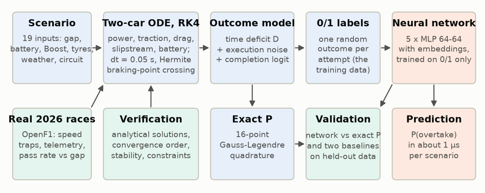

*Figure 1. Workflow. Top: the simulator generates 0/1 outcomes on which the
network is trained. Bottom: what checks each part.*

### 3.1 Physical model (`overtake/physics.py`)

Each car is a point mass moving along the straight, with position $x$, speed
$v$ and battery energy used $e$:

$$\dot x = v, \qquad m\,\dot v = \min(F_P, F_T) - F_D - F_R, \qquad \dot e = P_E .$$

* **Drive force** $F_P = \eta\,(P_{ICE} + P_E)/v$, with electrical power
  $P_E = s\,P_K(v)\,\min\big(1, (E-e)/S\big)$: $P_K$ is 350 kW to 290 km/h,
  falling to zero at 355 km/h (full power to 337 km/h with Overtake Mode); the
  deployment share $s$ is 1 with Boost and 0.55 on the standard map; $E$ is
  the energy available; over the last $S = 20$ kJ the power fades out, keeping
  the equations continuous.
* **Traction limit** $F_T = \mu\,w_r\,(mg + \tfrac12\rho C_LA\,v^2)$ of the
  driven rear tyres; it limits acceleration below about 180 km/h and carries
  tyre compound, age, temperature and wetness through the grip $\mu$.
* **Drag** $F_D = \tfrac12\rho\,C_DA\,k\,v^2$, where the follower's slipstream
  factor $k = 1 - 0.25\,e^{-\Delta x/20\,\mathrm{m}}$ fades to 1 over one car
  length as it draws alongside. **Rolling resistance**
  $F_R = c_{rr}(mg + \tfrac12\rho C_LA\,v^2)$.

The slipstream couples the cars, so all six states are integrated together
until the defender reaches the braking point, giving the attacker's remaining
time deficit $D$. Assumed: straight-line motion, constant aerodynamic
coefficients in the low-drag mode, full throttle from the corner exit.

*Table 2. Main parameters.*

| Parameter | Value | Source |
|---|---|---|
| MGU-K power; taper; Overtake Mode | 350 kW; 290 → 355 km/h; full power to 337 km/h and +0.5 MJ | regulations [1, 2, 4, 7] |
| Engine power; usable battery energy | 400 kW; 4 MJ | [5]; estimate [6] |
| Mass; $C_DA$, $C_LA$ | 800 kg; 1.0 m², 3.0 m² | estimates (768 kg minimum plus fuel) |
| $\mu$ (new soft, dry), $c_{rr}$, $\eta$; slipstream | 1.7, 0.012, 0.95; 25 % less drag, 20 m decay | estimates |

A car then reaches about 348 km/h after 800 m with Overtake Mode, 330 km/h
without and 303 km/h with no electrical power, consistent with real speed
traps (Section 5.3; traces in Figure A2).

### 3.2 Numerical methods

**Time integration: RK4 with a fixed step of 0.05 s.** RK4 is fourth-order
accurate for four right-hand-side evaluations per step (forward Euler: first
order; Section 4). Being explicit, it is stable only while $\lambda\,\Delta t$
stays within about 2.785 on the negative real axis, $\lambda$ being the
fastest decay rate in the system. That is not the car's speed (about
0.25 s⁻¹) but the battery ramp, where $\dot e \propto (E - e)$ decays at
$\lambda = sP_K/S = 17.5$ s⁻¹ with Boost: $\Delta t$ must stay below 0.16 s.
The 0.05 s step, set by the accuracy study (Section 6), leaves a margin of
three.

**Braking-point crossing.** Linear interpolation within the crossing step
would be only second-order accurate, so the crossing time is found by Newton
iteration on the step's cubic Hermite interpolant (fourth order). Scenarios
are **vectorised**: integrated together as NumPy arrays in chunks of 20,000,
each leaving the active set at its braking point.

### 3.3 Outcome model and exact probability (`overtake/simulator.py`)

Execution varies between attempts: the attacker's effective deficit is
$D - \varepsilon$ with $\varepsilon \sim N(0, \sigma)$, $\sigma = 0.20$ s in the
dry (0.24 damp, 0.28 wet, more for lower-rated drivers). Within $L = 0.15$ s
the attacker can lunge; with margin $u = \varepsilon - (D - L)$ the move sticks
with probability $\mathrm{logistic}(z_0 + 5\min(u, 0.5))$, where $z_0$
combines driver ratings, braking grip, corner type, weather and circuit
passability (estimated constants). The exact probability is a
one-dimensional integral,

$$P = \int_0^\infty \phi_\sigma(u + D - L)\;\mathrm{logistic}\big(z_0 + 5\min(u, 0.5)\big)\,du ,$$

with $\phi_\sigma$ the normal density of $\varepsilon$. The integral is split at
the kink $u = 0.5$ s: the tail has a closed form, and the smooth part is
evaluated with 16-point Gauss-Legendre quadrature, exact for polynomials up
to degree 31. Training labels are random draws of $\varepsilon$ and of
success; the exact $P$ is used only to validate.

### 3.4 Neural network (`overtake/model.py`, `overtake/train.py`)

Categorical inputs pass through learned embeddings (circuit 6 numbers, tyre
4, weather 2, segment 3); numeric inputs are standardised with training-set
statistics. The resulting 33 numbers feed a multilayer perceptron with two
hidden layers of 64 SiLU units, dropout 0.1 and a sigmoid output: 6,589
parameters. It is trained on 0/1 outcomes with binary cross-entropy, AdamW
[10] (learning rate 2×10⁻³, weight decay 10⁻⁴), batches of 1,024, and early
stopping on the validation loss (patience 5 epochs, at most 100). The final
model averages five networks trained from seeds 0-4. A network was chosen
because it learns from observed outcomes, so the pipeline transfers to real
attempts, and captures interactions simpler models cannot (battery charge
matters far more on a long straight than into a corner).
`notebooks/network_by_hand.ipynb` reproduces a prediction step by step.

### 3.5 Implementation and reproducibility

The package `overtake` has one module per stage (schema, physics, simulator,
network, training, baselines, prediction, experiments, figures, export, real
data); 67 pytest tests cover the numerics, pipeline and notebooks.
`python -m overtake.train` (4 min, 4-core CPU) and
`python -m overtake.experiments all` (about 25 min) regenerate every result;
work was done on Git feature branches merged into `main`.

## 4. Alternative solutions

*Table 3. Numerical methods.*

| Choice | Alternative | Evidence | Decision |
|---|---|---|---|
| RK4 | Forward Euler | At 0.05 s the worst deficit error is 0.013 s for Euler against 5.9×10⁻⁵ s for RK4; matching RK4's accuracy would take Euler about 100 times the run time; Euler's stability limit is also lower (0.11 s against 0.16 s) | RK4 |
| 16-point Gauss-Legendre | Simpson, trapezoid, Monte Carlo | 12 nodes already reach 2×10⁻¹⁵; Simpson needs 257 points for 3×10⁻¹¹; Monte Carlo with 1,600 replays has 0.7 points RMS error and is 189 times slower | Gauss-Legendre |

All learned models use the same inputs and training data and are judged on
the same 30,000 test attempts (Table 4; error by operating region in
Figure A1).

*Table 4. Learned models against direct simulation (test set).*

| | Neural network (5) | Gradient boosting | Logistic regression | Direct simulation |
|---|---|---|---|---|
| Mean error against exact P (points) | **2.0** | 3.8 | 15.7 | 0 (it is the truth) |
| Log loss / ROC AUC | **0.257** / **0.948** | 0.267 / 0.944 | 0.411 / 0.853 | - |
| Calibration error | 0.005 | 0.014 | 0.004 | - |
| Training time | 208 s | 4 s | 3 s | none |
| Prediction (µs per scenario, incl. input checks) | 4.1 | 8.6 | 3.6 | 94 |
| Model size | 132 kB | 1,139 kB | 4 kB | - |
| Interpretability | low (needs sensitivity analysis) | medium | high | high (physics) |
| Can learn from real outcomes | yes | yes | yes | no |

Logistic regression is fast and interpretable but cannot represent
interactions, so its error is largest where they dominate (straights, wet
tracks, mismatched tyres). Gradient-boosted trees train 48 times faster than
the network but are 1.9 times less accurate overall and worse in every region,
less well calibrated and larger; their piecewise-constant output approximates
smooth physics poorly. Direct simulation is exact but 23 times slower and
cannot learn from observed outcomes. The network is therefore the most
accurate model that can learn from outcomes, as well calibrated as the best,
at an acceptable cost.

## 5. Validation

Three questions were asked, each against a reference able to answer it: are
the equations solved correctly (5.1, exact solutions and theory); does the
network reproduce the simulator (5.2, exact probability on withheld data); and
is the simulator realistic (5.3, independent real race data)?

### 5.1 Verification of the numerical methods

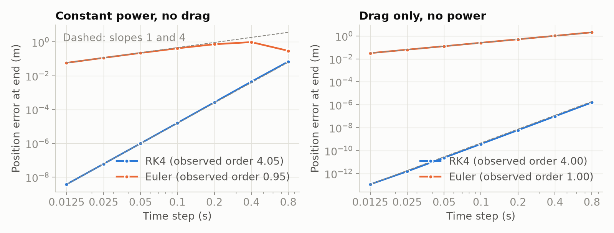

*Figure 2. Convergence against exact solutions: dashed lines have slopes 1 and
4.*

*Table 5. Verification checks, each with its acceptance criterion.*

| Check | Method | Acceptance | Result |
|---|---|---|---|
| Right-hand side, integrators | Exact solutions: constant power, $v^2 = v_0^2 + 2Pt/m$; drag only, $v = v_0/(1 + kv_0t/m)$ | relative error < 10⁻⁸ at 0.05 s | met |
| Order of accuracy | Slope of log error against log step (Figure 2) | Euler 1, RK4 4, each ± 0.15 | Euler 0.95, 1.00; RK4 4.05, 4.00 |
| Step size, full model | Deficit at 0.05 s against a 0.001 s reference, 2,000 random scenarios | worst error < 1 ms (0.5 % of $\sigma$) | 0.059 ms |
| Stability | Battery-depletion ramp at steps of 0.025-0.3 s | energy used ≤ energy available | met at 0.05 s; first violated at 0.125 s (RK4, Boost) |
| Physical constraints | Energy budget, speed bounds; direction of 10 input effects | always | met |
| Quadrature | Against SciPy's adaptive `quad` | error < 10⁻¹⁰ | met |
| Outcome sampling | 20,000 Monte Carlo replays against the exact $P$, 50 scenarios | within 4.5 standard errors | met |

**Error budget.** The numerical error in $P$ comes almost entirely from time
stepping, at most 0.059 ms in the deficit against 200 ms of execution noise;
quadrature (10⁻¹⁵) and the fourth-order crossing are negligible, and the
modelling error of Section 5.3 is far larger. The part most vulnerable to
numerical failure is the battery ramp: above 0.125 s, RK4 lets a car use
energy it does not have. The fixed step (margin 2.5) and a test of the energy
budget guard against it; an exponential integrator for the energy equation
would remove the limit if larger steps were needed.

### 5.2 Validation of the network against the exact probability

**Design.** The network never sees the exact probability: it learns from 0/1
outcomes, as it would from race data. The validation set (30,000 attempts)
served early stopping and every modelling choice; the test set (30,000) was
used once. The main metric is the **mean absolute error against the exact
probability**, in percentage points; outcome-only metrics that real data
would also allow (log loss, calibration error, ROC AUC) are reported
alongside. The network was judged against the best baseline in every
operating region, and on calibration.

**Results.** The mean error is 2.0 points (median 0.7, 90th percentile 5.6,
99th 15.6, worst 58.7), lower than gradient boosting in every region
(Figure A1), with a calibration error of 0.005. The network follows the exact
probability across the main what-if curves (Figure 3), including the sharp
drop when Overtake Mode is lost above 1 s.

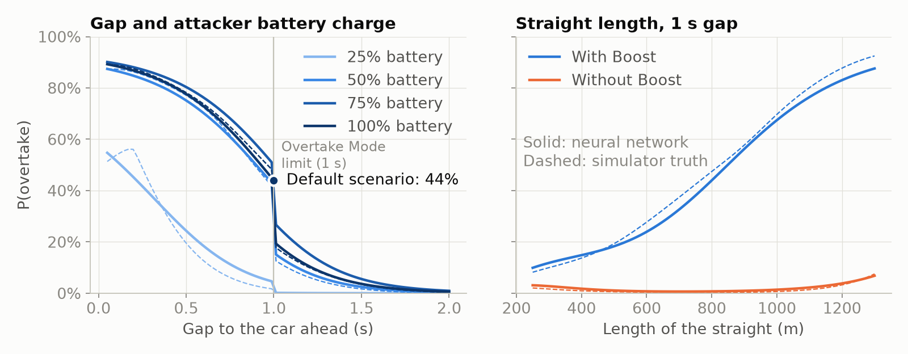

*Figure 3. Network (solid) against the exact probability (dashed) for the
default scenario, varying the gap and battery (left) and the straight's length
(right).*

**Failure modes.** (i) *Rare combinations*: with tyres unsuited to the
surface (slicks in the wet) the error is 2.6 points against 1.9; such attempts
are 18 % of the test set but half of the worst 1 % of errors. (ii) *A bias near
a full battery*: 3.5 points low at the default scenario (44 % against 47 %)
and up to 10.5 points low in the wet; a five-seed investigation (Appendix B)
showed that ensembling cannot remove it and that a physics-informed input
moved it rather than removing it. (iii) *Extrapolation*: on straights of
1,300-2,000 m, longer than any in training, the error rises to 4.4 points
(gradient boosting 9.7, logistic regression 26.9), hence the out-of-range
warning. A one-at-a-time sensitivity analysis (Appendix A) shows the network
responding to every input in the same direction as the simulator, with a
median difference of 2 points.

### 5.3 Validation of the simulator against real 2026 races

The simulator was compared with the 17 races of the 2026 season in OpenF1
[15] (`overtake/realdata.py`). No public source records battery charge or
Boost use, so the comparison is indirect. Of 4,289 recorded position changes,
removing lap 1 (962), safety-car, red-flag and Overtake-Mode-disabled periods
(852) and pit stops (1,253) leaves **1,222 on-track passes**; the filter was
checked by tracing individual passes back to the raw data (Appendix C).

* **Speed limit.** In 19,588 race laps the fastest speed-trap reading exceeds
  355 km/h on only 2 (358 km/h, in a slipstream), supporting the power taper.
* **Acceleration.** Over 135 full-throttle stretches of one car's telemetry
  at Monza, the RK4 car model started at the same speed fits best with the
  standard energy map (115 stretches; median RMS error 9.9 km/h, against 21.2
  with Boost). On the longest straight the real car peaks at 317 km/h and
  slows to 302 km/h before braking, running out of or saving energy; the
  model (324-332 km/h) does not.
* **Pass rate against gap** (Figure 4). The real chance falls much faster
  with the gap: at 0.75-1 s it is a fifth of its 0.25-0.5 s value, against
  two thirds in the simulator, then levels off at 2-5 % per lap beyond 1 s.
* **Circuits.** The simulator's circuit passability ranks real passes per lap
  with Spearman correlation 0.65 (p = 0.006, 16 circuits; 0.58 without
  Monaco).

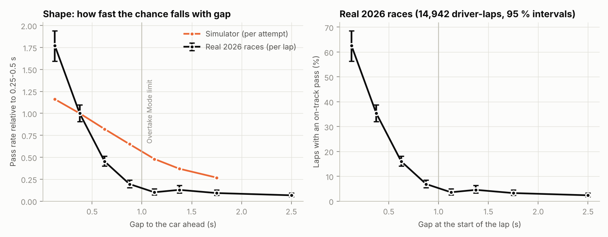

*Figure 4. Pass rate against the gap at the start of the lap: shape compared
with the simulator (left, both relative to 0.25-0.5 s) and real rates with
95 % Wilson intervals (right).*

The physics is plausible, but the outcome model is too optimistic at 0.5-1 s:
it gives the attacker more energy for one straight than real drivers spend.

### 5.4 Influence on model selection, and what validation cannot establish

Validation drove the main decisions: the convergence study exposed a
modelling error and, with the stability study, set the step (Section 6);
validation log loss with the one-standard-error rule [14] chose the network
size; five-seed comparisons chose the ensemble and rejected physics-informed
inputs. The test set was held back for the final comparison, and the real
data was not used for tuning, so it remains an independent check. Validation
cannot establish that the estimated constants are right for real cars, or the
network's accuracy on real attempts, whose battery and Boost inputs are
unknown; the real-data checks are indirect.

## 6. Optimisation and performance

The aim was an integration step and implementation accurate by a wide margin
at the lowest cost, and the smallest network that accuracy allows. Table 6
compares each baseline with the selected solution.

*Table 6. Baseline against selected solution.*

| Change | Baseline | Selected | Effect |
|---|---|---|---|
| Slipstream: instant switch-off when level, then fading over a car length | RK4 first order; worst error 1.1 ms at 0.05 s | 0.043 ms, same scenarios | 25 times more accurate |
| Time step (2,000 scenarios; Figure A4) | 0.0125 s: 1.43 s | 0.05 s: 0.40 s | 3.6 times faster; error 3,400 times below the noise |
| Loop over scenarios, then vectorised (200 scenarios) | 10.8 s | 0.23 s | 47 times faster |
| Chunk size (40,000 scenarios) | 1,000: 14.0 s | 20,000: 3.1 s | 4.5 times faster; 40,000 gains 3 % for twice the memory |
| Exact $P$: Monte Carlo (1,600 replays), then Gauss-Legendre | 90 µs, 0.7-point error | 0.48 µs, exact | 189 times faster |
| Single network, then ensemble of five | 2.24 ± 0.06 points | 2.02 points | 10 % lower error, 5 times the cost |
| Network: lowest validation loss (128-128-64), then one-standard-error rule (64-64) | 59,649 FLOPs | 13,313 FLOPs | 4.5 times cheaper, loss within one standard error |

**Profiling** (cProfile, 20,000 attempts) puts the run time in the numerical
core: force evaluation 26 %, integration loop and RK4 step 12 % each, power
taper 10 %; data handling and the network are negligible.

**FLOPs and arithmetic intensity.** One ensemble prediction costs 66,565
floating-point operations (from the layer sizes) and one simulation about
68,600 (153 RK4 steps of about 444 hand-counted FLOPs), yet the network is
about 120 times faster (0.82 µs against 100 µs, forward passes only). The
difference is arithmetic intensity: the network's dense matrix products reuse
each weight for every scenario in a batch, so intensity rises from 0.5
FLOP/byte for one prediction (memory-bound) to 251 at a batch of 1,024
(compute-bound, 81 GFLOP/s), while the simulator's many small element-wise
array operations stay memory- and overhead-bound (0.7 GFLOP/s). Memory is
modest (132 kB ensemble, 0.96 MB ODE state per chunk, 115 MB dataset), and
both scale linearly with the number of scenarios.

**Data requirements.** The error falls from 6.8 points with 10,000 training
attempts to 2.2 with 240,000 and is still falling, while a larger network does
not help (Appendix A): data, not size, limits accuracy. With perhaps a
thousand real attempts a season, real data would be used to fine-tune a
network pre-trained on simulation.

## 7. Limitations and lessons learned

**Limitations.** The model is only as realistic as the simulator (estimated
constants, one straight, a simple driver model, no labelled real attempts),
and against real races it is too optimistic from 0.5-1 s behind. The network
is less accurate for rare combinations, beyond its training range and near a
full battery (3.5 points low in the dry, up to 10.5 in the wet).

**Lessons.**

1. *Convergence studies find modelling errors, not only numerical ones*: RK4
   converging at first order exposed a discontinuity in the slipstream model.
2. *Stability is set by the fastest process, not the obvious one*: speed
   changes over seconds, but the battery ramp decays in 0.06 s and sets the
   step limit.
3. *One training run is not evidence*: the seed alone moves a single network's
   prediction by several points, so comparisons used five seeds.
4. *Hypotheses must be tested*: the obvious cause of the full-battery bias was
   wrong, and a fix that worked in one run moved the error in five.
5. *Verification is not validation*: every numerical check passed, yet real
   races showed one assumption (a full battery's worth of energy per attack)
   to be wrong. Filtering mattered as much as modelling: 72 % of recorded
   "overtakes" were the start, pit stops or safety-car periods.

**Improvements.** Model energy management across the lap (the main
discrepancy), fit the execution noise and circuit factors to the real
pass-rate curve and pass counts, and fine-tune the network on real attempts
if energy data become available.

## 8. AI use and reflection

### Disclosure

Claude Code (Anthropic) was used throughout, in a cloud development session.

| Task | What the AI did | How it was checked |
|---|---|---|
| Rules research | Summarised the 2026 rules; flagged conflicting reports | Sources in the references |
| Physics, numerics, network, experiments | Wrote the code, figures and tests | 67 automated tests; exact-solution, convergence and stability studies; every number regenerated by the code |
| Real-data comparison | Found the OpenF1 data; wrote the download, filtering and comparison | Filters tested on hand-made races; passes traced back to raw data |
| Documentation and presentation | Drafted the documentation, this report, slides and speaker notes | Checked against the results files |

Errors made by the AI and caught: a first simulator too crude for the unit; a
slipstream discontinuity (found by the time-step study); a stability argument
that missed the battery ramp; two wrong diagnoses of the full-battery bias;
tests with wrong expectations; and a real-data filter that counted
safety-car position changes as overtakes.

### Reflection

*To be written by Sam in his own words (the brief requires a personal
reflection). Cover: which tools were used and for what; the approximate level
of AI contribution; why AI was used for those tasks; how AI-generated material
was checked; which important decisions remained yours; errors, limitations or
unhelpful suggestions from the AI; and how AI use affected your understanding
and workflow.*

## References

1. Formula 1, "Explained: the key terms for Formula 1's new-for-2026 rules".
   <https://www.formula1.com/en/latest/article/explained-the-new-key-terms-for-formula-1s-new-for-2026-rules.3T5BU6TC9quGcIpGzoWkY0>
2. Formula 1, "Explained: 2026 power unit regulations".
   <https://www.formula1.com/en/latest/article/explained-2026-power-unit-regulations-fia.68izKQ2tn1voQPWvgLVMXN>
3. ESPN, "Formula 1's new terminology explained: Overtake Mode, Boost, and how it affects 2026 racing".
   <https://www.espn.com/f1/story/_/id/47333501/>
4. Crash.net, "'Manual Override Mode': F1's new overtaking aid - and DRS replacement - explained".
   <https://www.crash.net/f1/news/1050188/1/manuel-override-mode-f1s-new-overtaking-aid-and-drs-replacement-explained>
5. PMW Magazine, "FIA signs off 2026 F1 PU rules with MGU-H dropped and tight constraints on ICE design".
   <https://pmw-magazine.com/news/race-series-news/fia-signs-off-2026-f1-pu-rules-with-mgu-h-dropped-and-tight-constraints-on-ice-design.html>
6. Honda, "2026 Formula 1 Regulations Overview". <https://global.honda/en/F1/features/2026_Commentary/regulations/>
7. FIA, 2026 Formula 1 Technical Regulations, Section C (Power Unit), Issue 4, 2023.
   <https://FIA.com/sites/default/files/fia_2026_formula_1_technical_regulations_pu_-_issue_4_-_2023-10-25.pdf>
8. The Race, "Boost, overtake mode, active aero: key 2026 F1 terms explained".
   <https://www.the-race.com/formula-1/boost-overtake-mode-active-aero-recharge-key-2026-terms-explained>
9. S. C. Chapra and R. P. Canale, *Numerical Methods for Engineers*, McGraw-Hill (Runge-Kutta methods, stability, Gauss quadrature).
10. I. Loshchilov and F. Hutter, "Decoupled weight decay regularization", ICLR 2019 (AdamW).
11. C. Guo, G. Pleiss, Y. Sun and K. Q. Weinberger, "On calibration of modern neural networks", ICML 2017 (calibration error).
12. F. Pedregosa et al., "Scikit-learn: machine learning in Python", JMLR 12, 2011.
13. A. Paszke et al., "PyTorch: an imperative style, high-performance deep learning library", NeurIPS 2019.
14. T. Hastie, R. Tibshirani and J. Friedman, *The Elements of Statistical Learning*, 2nd ed., Springer, 2009, Section 7.10 (one-standard-error rule).
15. OpenF1, free API of Formula 1 timing data. <https://openf1.org> (2026 races, accessed October 2026).
16. E. B. Wilson, "Probable inference, the law of succession, and statistical inference", *Journal of the American Statistical Association* 22, 1927 (score interval).

---

## Appendix A. Supplementary figures

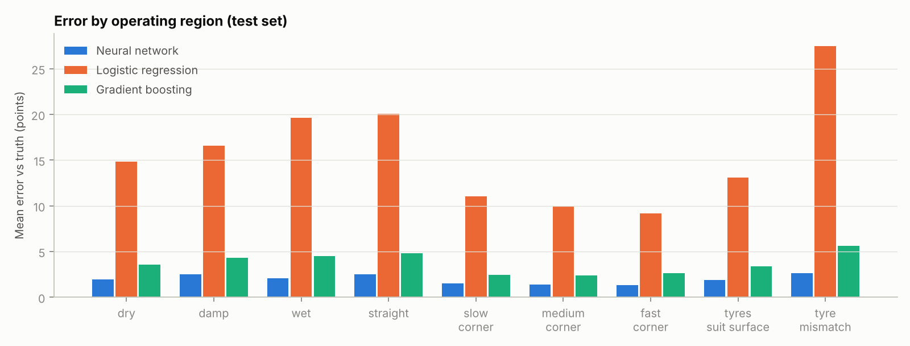

*Figure A1. Mean error against the exact probability by operating region
(test set).*

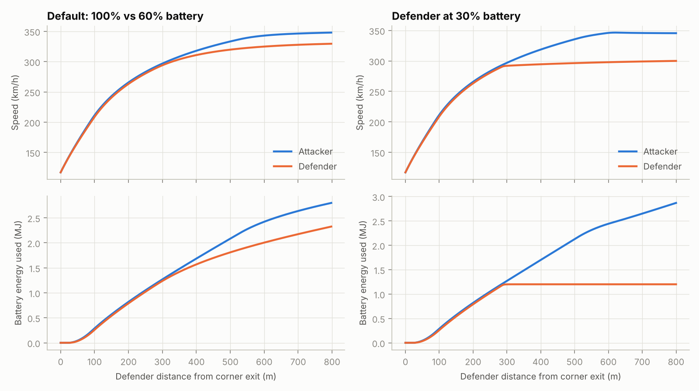

*Figure A2. Simulated speed and battery energy along an 800 m straight:
default scenario (left) and a defender with only 30 % charge, who runs out of
energy mid-straight (right).*

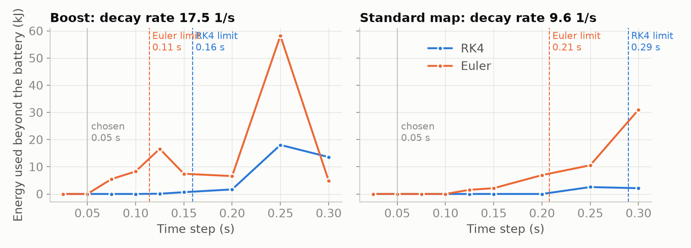

*Figure A3. Energy used beyond the battery against time step on the
battery-depletion ramp, with the stability limits predicted from each
method's stability region (`experiments stability`).*

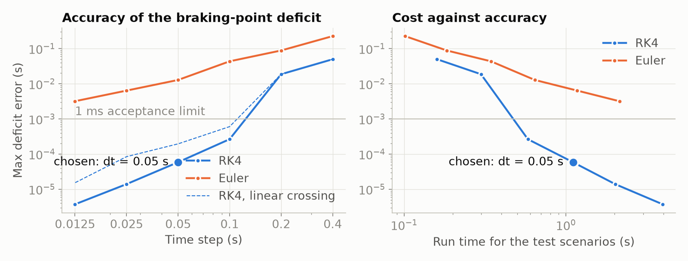

*Figure A4. Worst deficit error against time step (left) and run time (right),
full two-car model; the chosen step is marked.*

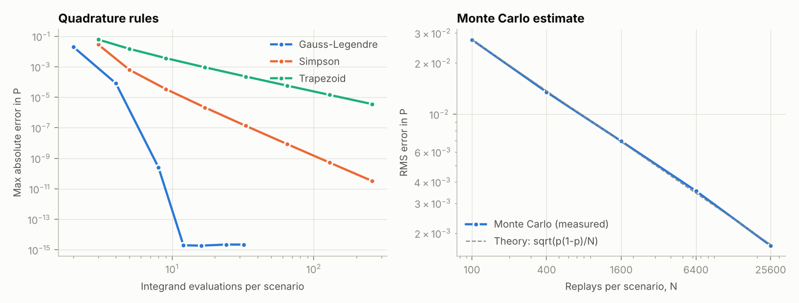

*Figure A5. Quadrature rules and Monte Carlo against a 200-node reference.*

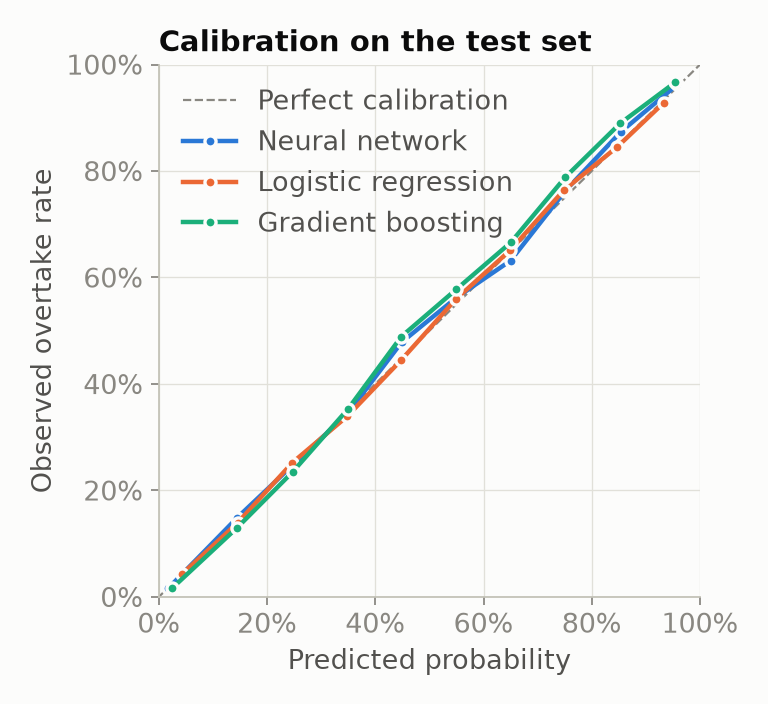

*Figure A6. Calibration of the three learned models on the test set.*

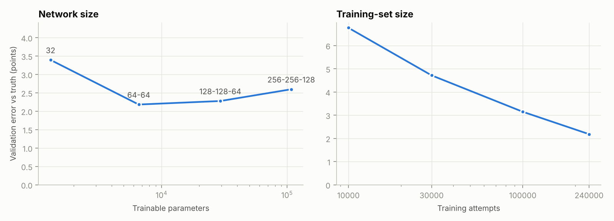

*Figure A7. Network size (left) and training-set size (right), validation set.*

*Table A1. Network sizes (validation set).*

| Hidden layers | Parameters | FLOPs per prediction | Validation log loss ± standard error | Error against exact P (points) |
|---|---|---|---|---|
| 32 | 1,309 | 2,369 | 0.2671 ± 0.0029 | 3.4 |
| 64-64 (selected) | 6,589 | 13,313 | 0.2594 ± 0.0029 | 2.2 |
| 128-128-64 | 29,373 | 59,649 | 0.2591 ± 0.0029 | 2.3 |
| 256-256-128 | 107,709 | 217,601 | 0.2606 ± 0.0030 | 2.6 |

The one-standard-error rule was adopted after two runs on different data
ranked 64-64 and 128-128-64 in opposite orders by less than 0.001: choosing
the raw minimum would have chosen on noise.

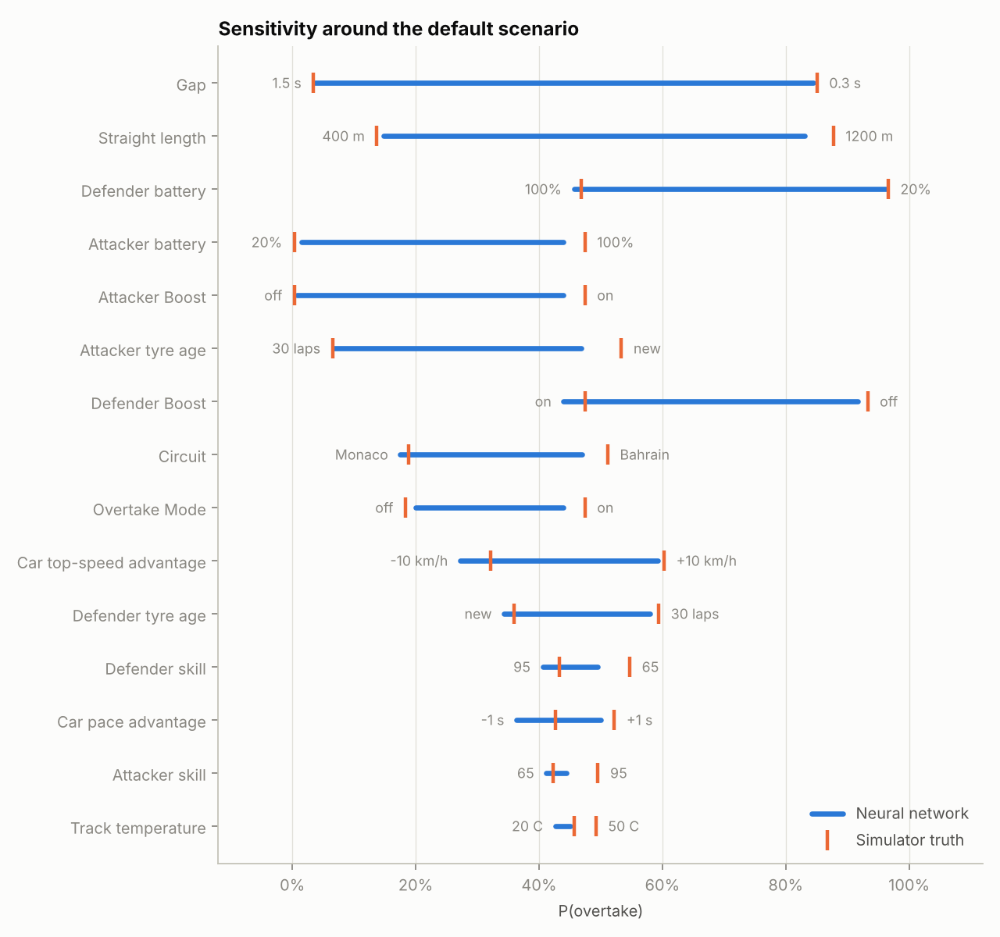

*Figure A8. One-at-a-time sensitivity around the default scenario: network
(bars) against the exact probability (ticks). Gap, straight length and the two
batteries matter most; driver ratings and track temperature least.*

## Appendix B. The full-battery bias

Sensitivity analysis showed the first single network 6 points low at the
default scenario, with the error growing as the attacker's battery rose above
80 %. Three explanations were tested in turn. (1) *Too little training data at
a full battery*, the edge of a uniform 0-100 % distribution: making 15 % of
training attempts start full (realistic, so kept) did not reduce the error.
(2) *The network smooths a sharp corner*: along the battery axis the exact
probability rises steeply and stops abruptly near 60 %, where the battery
first covers the straight; two physics-informed inputs (each car's battery
energy divided by the energy needed for full power along the straight, capped
at 1) were added to hand the network that corner. (3) *Run-to-run variation*
between training seeds. Explanations 2 and 3 were tested together over five
seeds (`experiments ablation`, validation set):

| | Mean error (points) | Log loss | Error at default scenario (points) | Worst error along battery axis (points) |
|---|---|---|---|---|
| Raw inputs, single network (mean ± sd) | 2.24 ± 0.06 | 0.2595 ± 0.0004 | -3.5 ± 2.5 | 7.8 ± 2.0 |
| Raw inputs, ensemble of 5 | 2.02 | 0.2585 | -3.5 | 7.4 |
| Energy-cover inputs, single network (mean ± sd) | 2.18 ± 0.04 | 0.2589 ± 0.0004 | +0.3 ± 2.5 | 12.6 ± 4.3 |
| Energy-cover inputs, ensemble of 5 | 1.97 | 0.2580 | +0.3 | 12.6 |

The seed alone moves the default-scenario error by about ±2.5 points, so the
first network's -6 points was partly bad luck. Ensembling cut the mean error
by about 10 % with either input set, but cannot remove a bias that all runs
share. The energy-cover inputs removed the bias at the default scenario but
made the worst error along the battery axis larger, because their energy
estimate ignores the power taper above 290 km/h and puts the corner at about
75 % instead of 60 %. Their log-loss gain (0.0005) is well within one standard
error (about 0.003), so the simpler model was kept: raw inputs, ensemble of
five. On a wet track with intermediates the remaining bias grows to 10.5
points at a full battery (20 % against 30 %), although across all 1,569 wet
straights in the test set the error averages 2.8 points with no overall bias.

## Appendix C. Real-data comparison details

`python -m overtake.experiments real`; results in
`reports/results/real_data.json`. Position changes are classified by the first
rule that applies: *start* (lap 1, 962); *neutralised* (852): during a safety
car, virtual safety car or red flag, or while race control had disabled
Overtake Mode, taken from race-control messages; *pit stop* (1,253): either
car pitted on that lap or the lap before, or is on its pit-out lap; *on track*
(1,222, 28 %). Checking individual passes against the raw rows exposed the
need for the neutralised rule: at Monza a "pass" on lap 6 was made behind the
safety car after a red flag, on a 148 s lap against a normal 88 s.

*Table C1. Pass rate per lap against the gap at the start of the lap
(14,942 driver-laps; 95 % Wilson intervals [16]).*

| Gap | Driver-laps | Real pass rate | Relative to 0.25-0.5 s | Simulator, relative |
|---|---|---|---|---|
| 0-0.25 s | 233 | 63 % (56-69) | 1.77 | 1.16 |
| 0.25-0.5 s | 801 | 35 % (32-39) | 1.00 | 1.00 |
| 0.5-0.75 s | 1,250 | 16 % (14-18) | 0.45 | 0.82 |
| 0.75-1 s | 1,061 | 6.9 % (5.5-8.6) | 0.19 | 0.65 |
| 1-1.25 s | 841 | 3.6 % (2.5-5.0) | 0.10 | 0.48 |
| 1.25-1.5 s | 705 | 4.5 % (3.2-6.3) | 0.13 | 0.37 |
| 1.5-2 s | 1,078 | 3.2 % (2.3-4.5) | 0.09 | 0.27 |
| 2-3 s | 1,532 | 2.3 % (1.7-3.2) | 0.07 | outside simulated range |

The rates are per lap for real races and per attempt for the simulator, over
different mixes of situations, so only their shapes are compared. A sharp step
at the 1 s threshold would be blurred in the real data, because the gap is
measured at the start of the lap rather than at the detection point.

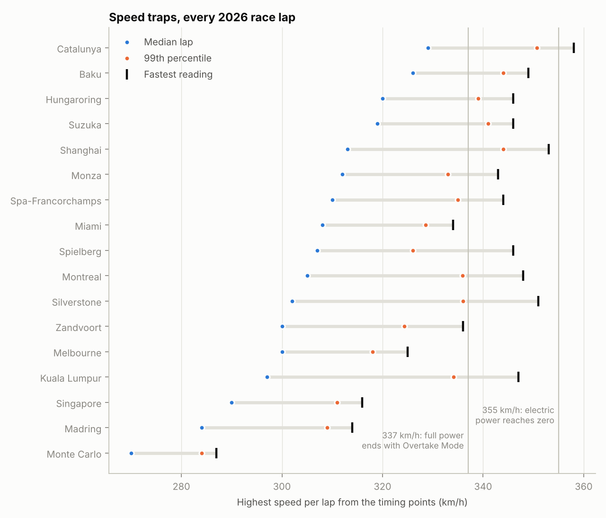

*Figure C1. Fastest speed-trap reading per lap, every 2026 race.*

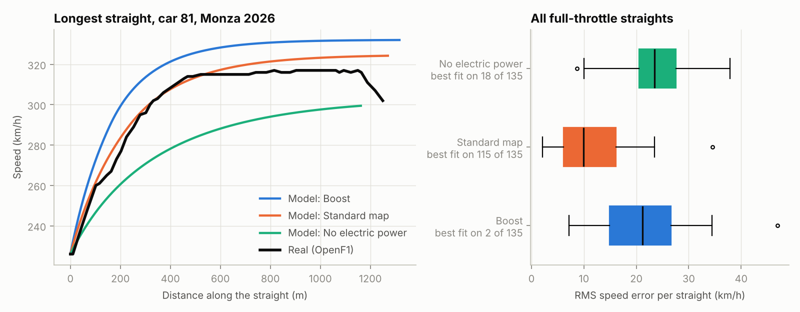

*Figure C2. Real full-throttle speed against the RK4 car model: the longest
straight at Monza (left) and the RMS error over all 135 straights (right).*

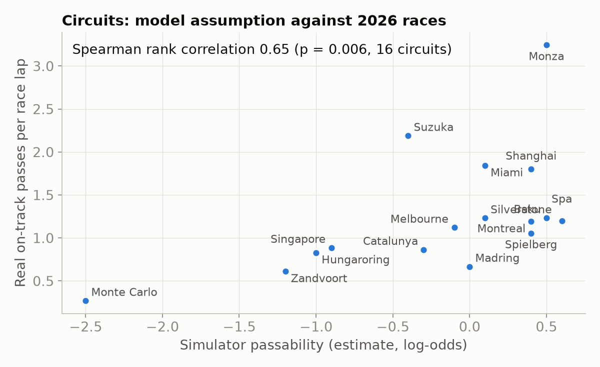

*Figure C3. Real on-track passes per lap against the simulator's circuit
passability.*

## Appendix D. Reproducing the results

| Result | Command | Output |
|---|---|---|
| Train the network and baselines | `python -m overtake.train` | `models/overtake_net.pt`, `reports/results/test_metrics.json` |
| Every experiment and figure | `python -m overtake.experiments all` | `reports/results/*.json`, `reports/figures/*.png` |
| Verification (Table 5, Figures 2, A3-A5) | `experiments solver timestep stability quadrature` | `solver.json`, `timestep.json`, `stability.json`, `quadrature.json` |
| Model selection (Tables 6, A1; Figure A7; Appendix B) | `experiments selection ablation` | `selection.json`, `ablation.json` |
| Comparison (Table 4, Figures A1, A6) | `experiments comparison` | `comparison.json` |
| Performance (Table 6, Figure A4) | `experiments performance` | `performance.json` |
| Sensitivity (Figures 3, A8) | `experiments sensitivity` | `sensitivity.json` |
| Real races (Section 5.3, Figure 4, Appendix C) | `experiments real` (downloads about 80 MB once) | `real_data.json` |
| Tests and report | `python -m pytest --html=reports/test_report.html --self-contained-html` | `reports/test_report.html` |
| API documentation | `pdoc overtake --docformat numpy -o docs/api` | `docs/api/` |
